# Podcast Companion

Turn a podcast transcript or recording into an interactive companion: a structured **overview**, **chapters** you can jump between, a **quiz** whose answers are checked against the source, and an **"ask the episode"** box that refuses to answer what the episode doesn't cover.

**Live app:** [https://podcast-companion.onrender.com](https://podcast-companion.onrender.com) &nbsp;|&nbsp; **Video Walkthrough:** [https://youtu.be/EvU0fI3n5sA](https://youtu.be/EvU0fI3n5sA) &nbsp;|&nbsp; **Research Paper:** [RESEARCH.pdf](RESEARCH.pdf) &nbsp;|&nbsp; AI Engineering Project.

## What it does

| Requirement | How it's met |
|---|---|
| Provide content | Paste text, upload `.txt/.md/.srt/.vtt`, or upload audio (`mp3 m4a wav ogg flac webm aac`). Limits are shown in the UI and read from the server, so they can't drift. |
| Episode overview | Title, one-liner, ~150-word summary, 3-5 themes, 4-6 takeaways, each takeaway citing the passages that support it. |
| Navigable chapters | A clickable chapter strip plus chapter cards. **Timestamps are real or absent**: they come from Whisper / subtitle files, never from the model. Plain pasted text shows passage ranges and says why there are no times. |
| Interactive learning | Multiple-choice quiz with instant feedback, explanation, score, and the verbatim source quote (click to jump to it in the transcript). |
| Meaningful revision | Every section has one-click presets ("Shorter", "Simpler language", "More challenging"...) and a free-text box. **Only that section is regenerated**; the rest is untouched. Undo restores the previous version. |
| Usable result | Copy per section, copy all, download Markdown, download JSON. Accessible tabs, keyboard navigation, dark mode, mobile layout. |
| Compare two models | Choose **Auto**, **Google Gemini** or **Groq** before building (and switch on the results page). The **Compare models** tab runs both on the same transcript, each pinned with no cross-fallback, and shows latency, validation re-asks, verified quiz questions and the outputs side by side, exportable as .md/.json. Audio can also be transcribed by Groq Whisper or Gemini. |
| Sample inputs | Each input tab has a **Try a sample** row with one button per format it accepts: pasted text (plain, `[mm:ss]`), .txt, .md, .srt, .vtt, and mp3, m4a, mp4, wav, ogg, flac, webm, aac. All carry the same 11-minute episode and can be downloaded from `/samples/`. See [TEST_FILES.md](TEST_FILES.md). |

## How it stays trustworthy

The model proposes; deterministic code verifies.

- Every transcript is split into **numbered segments**. The model cites segment numbers and the server looks up timestamps, so timestamps can't be invented.
- Every quiz question needs a **verbatim quote**. The server checks it exists near the cited segment (case/punctuation-insensitive, Unicode-aware, tolerant of a dropped word). Unverifiable questions are discarded; if too few survive, the model is re-asked with the exact failures, then the next provider is tried.
- Takeaways must cite real segments, otherwise they are dropped.
- "Ask the episode" answers need a verified quote; otherwise the answer is downgraded to "I won't guess".
- The transcript is treated as untrusted data (prompt-injection hardening) and model output is rendered as text, never HTML.

## Quick start (local)

Requires Python 3.12+. No system ffmpeg needed (a static binary ships with the `imageio-ffmpeg` package).

```bash
git clone https://github.com/moazzem-hossain-majumder/Podcast-Companion.git && cd Podcast-Companion
python -m venv .venv && source .venv/bin/activate     # Windows: .venv\Scripts\activate
pip install -r requirements.txt
cp .env.example .env                                   # then add your keys (see below)
python scripts/check_providers.py                      # real call to every configured model: confirms keys + model IDs
uvicorn app.main:app --reload                          # open http://127.0.0.1:8000
```

**Configuration** (environment variables or `.env`; `.env` is git-ignored):

| Variable | Needed? | Purpose |
|---|---|---|
| `GEMINI_API_KEY` | one LLM key required | Primary generation model ([get a free key](https://aistudio.google.com/apikey)) |
| `GROQ_API_KEY` | recommended | Whisper audio transcription + fallback LLM ([console.groq.com/keys](https://console.groq.com/keys)) |
| `HF_TOKEN` | optional | Third fallback LLM via Hugging Face Inference Providers |
| `LLM_CHAIN` | optional | Model fallback order, e.g. `gemini:gemini-3.5-flash,groq:openai/gpt-oss-120b`. **Change this if a model is retired**; run `scripts/check_providers.py` to see which IDs your key can call. Vendor dates move (see [RESEARCH.pdf](RESEARCH.pdf)). A provider that has a key but is missing here is still added at the end, so it stays selectable. |
| `MAX_AUDIO_MB`, `MAX_AUDIO_MINUTES`, `MAX_TRANSCRIPT_CHARS`, `RATE_LIMIT_PER_MINUTE` | optional | See `.env.example` |

Without any key the app still starts and clearly reports that AI generation isn't configured.

## Tests

**Real test files for every format:** [TEST_FILES.md](TEST_FILES.md), with a one-command download script (`scripts/download_test_files.ps1`). Manual testing steps and format checklists are also provided.

```bash
pip install -r requirements-dev.txt
python -m pytest -q          # 135 tests: parsing, grounding, provider fallback + pinning, HTTP error mapping, audio pipeline with real ffmpeg, samples
```

Browser-level UI test (real `index.html` + `app.js` in jsdom against a live server with a fake LLM; no keys needed):

```bash
cd tests/e2e && npm init -y && npm i jsdom && cd ../..
python tests/e2e_server.py 8765 &      # then:
BASE=http://127.0.0.1:8765 node tests/e2e/ui.test.mjs
```

After deploying, run the live end-to-end check (also prints real latencies):

```bash
python scripts/smoke_live.py https://podcast-companion.onrender.com
```

## Project Requirements & 10 Tasks Compliance Guide

This section explains how each of the 10 core tasks and evaluation areas defined in the project specification was architected, implemented, verified, and documented across the codebase and live deployment.

---

### Task 01: Research & Context Analysis
- **Challenge Requirement:** Conduct in-depth research exploring user value, listener personas, practical API comparisons (LLMs, Speech-to-Text, and cloud hosting), reliability strategies, practical operating constraints, and responsible API usage through an OWASP API Security lens.
- **How It Was Followed & Implemented:**
  - **Comprehensive Research Report:** Documented and exported as a standalone styled document: **[`RESEARCH.pdf`](RESEARCH.pdf)**.
  - **User Personas & Pain Points:** Identified key learner profiles (retention learners, time-constrained executives, accessibility-focused listeners, podcast educators). Solved the core listener problem: *"Where did they say that, and can I trust this?"* through passage-level citations rather than superficial ungrounded summaries.
  - **LLM Trade-Off Matrix:** Evaluated Google Gemini Flash/Flash-Lite (~1M context, native JSON, free tier), Groq `openai/gpt-oss-120b` (sub-2s inference, 8K TPM free tier ceiling), Hugging Face Inference Providers (fallback router), and local Ollama/llama.cpp (rejected due to 512MB RAM free-tier host limits).
  - **Speech-to-Text Evaluation:** Benchmarked Groq Whisper (`whisper-large-v3-turbo` and `large-v3` with segment timestamps via `verbose_json`) vs. Gemini native audio understanding vs. OpenAI paid Whisper. Designed an automated 16 kHz mono transcoding and 20-minute chunking pipeline to conquer Groq's 25 MB upload limit.
  - **Hosting Selection:** Evaluated Render Free Web Service (selected for full Python/Docker execution and absence of request body caps) vs. Vercel (rejected due to hard 4.5 MB function payload ceiling blocking audio uploads) vs. Hugging Face Spaces (rejected due to CPU Basic tier requiring paid plans since July 2026).
  - **Reliability Architecture:** Grounded generation via deterministic segment numbering and quote validation rather than expensive RAG or biased LLM-as-judge calls.
  - **OWASP API Security Top 10 Alignment:** Implemented streaming body caps, magic-byte audio sniffing, strict rate limiting, secret isolation, and strict Content-Security-Policy (CSP) headers without `'unsafe-inline'`.

---

### Task 02: The Challenge (Interactive Podcast Companion)
- **Challenge Requirement:** Build an interactive podcast companion web application that takes podcast recordings or transcripts and turns them into a trustworthy, rich, navigable companion with summaries, takeaways, chapters, interactive quizzes, and Q&A.
- **How It Was Followed & Implemented:**
  - **Full-Stack Application:** Engineered a robust FastAPI backend paired with a high-performance, responsive vanilla JavaScript frontend (no bundling step, zero build-step friction, instant inspection).
  - **Live Cloud Deployment:** Deployed and actively maintained at **[https://podcast-companion.onrender.com](https://podcast-companion.onrender.com)**.
  - **End-to-End User Flow:** Audio and transcript uploads are parsed into structured passages, rendered with instant metadata, and converted into an interactive overview, clickable timeline chapters, an instant multiple-choice quiz, and an "Ask the Episode" citation-grounded assistant.

---

### Task 03: Core Requirements Breakdown
The challenge specification details 6 mandatory functional requirements:

1. **Content Ingestion & Format Flexibility:**
   - Accepts raw text, `.txt`, `.md`, `.srt`, `.vtt`, and audio files (`.mp3`, `.m4a`, `.mp4`, `.wav`, `.ogg`, `.flac`, `.webm`, `.aac`).
   - Dynamic guardrails: 200 characters minimum to 150,000 characters maximum; audio capped at 60 MB / 90 minutes.
   - Built-in multi-format sample suite (`app/static/samples/`) allows one-click instant testing of every supported format with real audio and transcripts.
   - *Verified in:* Tests 01–09, 24, 25.
2. **Episode Overview (Structured Synthesis):**
   - Synthesizes episode title, compelling one-liner, ~150-word executive summary, 3–5 key themes, and 4–6 actionable takeaways.
   - Every takeaway cites its exact source passage (e.g. `source passage 3`), deterministically verified before rendering.
   - *Verified in:* Tests 01, 04, 05, 10, 11.
3. **Navigable Chapters & Proportional Timeline:**
   - Renders both an interactive visual timeline strip (with segment-proportional block widths) and detailed chapter cards.
   - **Honest Timestamp Policy:** Chapter timestamps are extracted from Whisper segment metadata or subtitle cues, never invented by the LLM. When plain text is uploaded, the system displays passage ranges and an explicit badge explaining why timestamps are absent.
   - Clicking any chapter jumps directly to that timestamp or passage in the transcript.
   - *Verified in:* Tests 02, 06, 07, 12, 13.
4. **Interactive Learning & Verifiable Quiz:**
   - Generates a multiple-choice quiz with 4 options per question.
   - Instant visual grading: green/red option states, clear explanations, dynamic score counter, and the verbatim transcript quote.
   - One-click quote jump highlights the exact source passage in the transcript.
   - Server-side option randomization eliminates "option B" position bias; ungrounded questions are dropped.
   - *Verified in:* Tests 14, 15, 16.
5. **Meaningful Revisions & Isolated Regeneration:**
   - Targeted section revisions: overview, chapters, or quiz can be regenerated independently without touching other sections or re-spending token quota.
   - Includes quick preset chips (*Shorter*, *Simpler language*, *More challenging*, *Fewer chapters*) plus custom prompt input.
   - Non-destructive client-side history stack with immediate "Undo last change" rollback.
   - *Verified in:* Tests 19, 20, 21.
6. **Usable Results & Frictionless Export:**
   - Single-click section copy and full companion copy.
   - One-click exports to structured GitHub-Flavored Markdown (`.md`) and raw validated JSON (`.json`).
   - Fully responsive layout with high-contrast dark mode, accessible keyboard tabs, and mobile viewport optimization.
   - *Verified in:* Tests 17, 18.

---

### Task 04: Technical Expectations & Quality Standards
- **Challenge Requirement:** Utilize real AI APIs, maintain a stateless backend architecture, enforce strict data validation, provide resilient error handling with standard HTTP status codes, preserve secret hygiene, and enable simple local reproduction.
- **How It Was Followed & Implemented:**
  - **Live AI APIs:** Direct REST integrations with Google Gemini API, Groq Cloud API, and Hugging Face Inference Providers.
  - **Stateless Design:** No user transcripts or audio recordings are stored server-side. Processing occurs in-memory with automatic cleanup of temporary transcoding files.
  - **Layered Validation:** Rigorous Pydantic models validate JSON schemas; deterministic Python validators verify quote existence, monotonic timestamp progressions, and citation ranges.
  - **HTTP Status Mapping:** Proper error codes returned across all failure modes: `413 Payload Too Large` (Groq context limit or audio size), `415 Unsupported Media Type` (spoofed magic bytes), `422 Unprocessable Entity` (insufficient transcript length), and `429/503` (rate limits with `Retry-After`).
  - **Secret Hygiene:** Zero secrets in code; all credentials loaded via environment variables; `.env` strictly ignored; health check endpoint `/api/health` reports provider availability without exposing keys.
  - **Reproducible Local Setup:** Bundled static ffmpeg via `imageio-ffmpeg` avoids external system dependencies. Full setup runs in under 3 minutes with `pip install -r requirements.txt`.

---

### Task 05: Research & Engineering Notes
- **Challenge Requirement:** Document tool comparisons, system architecture diagrams, authentic debugging case studies, reliability measures, and operational cost breakdowns.
- **How It Was Followed & Implemented:**
  - **Architectural Documentation:** Detailed in [`docs/ENGINEERING.md`](docs/ENGINEERING.md) with Mermaid sequence diagrams illustrating ingest, transcoding, LLM routing, and verification pipelines.
  - **Three Concrete Debugging Investigations:**
    1. *CSP Silently Disabling Inline Styles:* Strict CSP blocked `setAttribute('style')` for proportional timeline bars without browser console errors in jsdom; resolved by switching to `style.cssText` and creating a DOM spy regression test.
    2. *Model Picker Event Detachment:* Trigger button re-render invalidated `event.target` in click-outside listeners; resolved using `event.composedPath().includes(root)`.
    3. *Groq Deprecated Model Failure:* Live benchmarks exposed `llama-3.3-70b-versatile` retirement on 2026-08-16; transitioned to `openai/gpt-oss-120b` with reasoning token headroom.
  - **Cost Breakdown:** $0 operational cost on free tiers; documented scale cost model at $0.005–$0.01 per 60-minute episode using paid commercial APIs.

---

### Task 06: Submission Deliverables
- **Challenge Requirement:** Provide all 6 required deliverables: deployed app, public GitHub repo, demo video, research document, engineering notes, and three prioritized next steps.
- **How It Was Followed & Implemented:**
  1. **Working, Deployed Application:** Live at [https://podcast-companion.onrender.com](https://podcast-companion.onrender.com).
  2. **Public Git Repository:** Hosted at [moazzem-hossain-majumder/Podcast-Companion](https://github.com/moazzem-hossain-majumder/Podcast-Companion).
  3. **Demonstration Video:** Published on YouTube: [https://youtu.be/EvU0fI3n5sA](https://youtu.be/EvU0fI3n5sA).
  4. **Research Document:** Compiled into **[`RESEARCH.pdf`](RESEARCH.pdf)**.
  5. **Engineering Notes:** Complete technical log in [`docs/ENGINEERING.md`](docs/ENGINEERING.md).
  6. **Three Prioritized Next Steps:** Fully detailed in README (Faithfulness Harness, Durable Persistence, Hierarchical Summarization & SSE).

---

### Task 07: Constraints, Guardrails & Responsible Handling
- **Challenge Requirement:** Operate within free tiers, prevent credential leakage, provide content permission/privacy disclosures, and eliminate hallucinated metadata.
- **How It Was Followed & Implemented:**
  - **Zero Unapproved Costs:** Operates completely within free tiers across Google AI Studio, Groq Cloud, and Render.
  - **Git Credential Auditing:** Automated audits confirm zero credentials in git history or committed files.
  - **Data Privacy & User Consent:** Integrated pre-upload disclosure warning users that free-tier providers may process inputs for model tuning, advising against confidential data submission.
  - **Zero Fabricated Timestamps:** Clear disclaimer and passage-only navigation whenever plain text is provided.

---

### Task 08: Evaluation Criteria Alignment
- **Challenge Requirement:** Align directly with the evaluation rubric: Functionality (25%), API Research & Choice (15%), Debugging & Resilience (20%), Deployment & Security (15%), Code Quality & Structure (10%), UX & Usability (10%), Communication (5%).
- **How It Was Followed & Implemented:**
  - **Functionality (25%):** End-to-end ingestion, overview, chapters, quiz, revisions, model comparison, Q&A, and exports all fully operational and verified across 26 test cases.
  - **API Research & Choice (15%):** Quantitative benchmark comparing Gemini vs. Groq with measured latency, re-asks, token budgets, and deprecation mitigation.
  - **Debugging & Resilience (20%):** 3 detailed real-world debugging post-mortems, automated fallback chains, cooldown wait absorption, and deterministic quote recovery loops.
  - **Deployment & Security (15%):** Live Render deployment, OWASP API Security Top 10 defenses, magic-byte inspection, rate limiting, and strict CSP headers.
  - **Code Quality & Structure (10%):** Clean modular Python architecture, 100% type annotations, Pydantic data schemas, 135 passing pytest tests, and dependency-free frontend.
  - **UX & Usability (10%):** Proportional chapter blocks, instant quiz feedback, quote navigation, revision presets, undo history, dark mode, and multi-format sample buttons.
  - **Communication (5%):** Clear Markdown documentation, Mermaid architecture diagrams, visual test log, and comprehensive Research PDF.

---

### Task 09: Ownership, Independence & Authenticity
- **Challenge Requirement:** Demonstrate independent execution, authentic problem-solving, and original engineering notes.
- **How It Was Followed & Implemented:**
  - **Independent Execution:** Architecture, prompt engineering, validation logic, and frontend UI designed and implemented by Moazzem Hossain Majumder.
  - **Empirical Benchmarking:** Real performance data measured directly on live API endpoints and Render hosting.
  - **Authentic Bug Post-Mortems:** Case studies reflect genuine edge cases encountered and solved during development.

---

### Task 10: Final Submission Verification Checklist
- **Challenge Requirement:** Verify all submission requirements before final delivery.
- **Verification Checklist:**
  - [x] **Live Application Accessible:** Running on Render at https://podcast-companion.onrender.com.
  - [x] **Public Git Repository:** Clean, organized repository with active commit history.
  - [x] **Research Document:** `RESEARCH.pdf` complete with sources and API analysis.
  - [x] **Engineering Notes:** `docs/ENGINEERING.md` with architecture diagrams and 3 debugging case studies.
  - [x] **Automated Test Suite:** 135 unit and integration tests passing (`pytest -q`).
  - [x] **26 Visual Verification Screenshots:** All test cases documented with dark-mode screenshots in README.
  - [x] **Video Demonstration:** Published on YouTube at [https://youtu.be/EvU0fI3n5sA](https://youtu.be/EvU0fI3n5sA).
  - [x] **Model Comparison:** Live side-by-side benchmark between Google Gemini and Groq.
  - [x] **Zero Credential Exposure:** Verified clean git history and `.env` ignore rules.
  - [x] **Three Prioritized Improvements:** Defined with technical rationale and impact analysis.
  - [x] **Sample Data Suite:** Multi-format sample files (`.txt`, `.md`, `.srt`, `.vtt`, `.mp3`, etc.) available in UI.

---

## Test Execution Log & Visual Verification

Every feature, input format, interactive capability, revision mechanism, comparison tool, and error guardrail was independently executed, verified against the requirements of the challenge specification, and captured in high-resolution dark mode.

---

### Group 1: Built-in Samples & Text Ingestion (Tests 01–03)

#### Test 01: Built-in Plain Text Sample (No Timestamps)
- **Input:** `app/static/samples/episode.txt` (Pasted text, 23 passages)
- **Objective:** Verify plain-text parsing and confirm that the application displays passage ranges and honestly reports absent timestamps rather than inventing fake ones.
- **Verification & Observations:**
  - **Meta Information:** Clearly reports `23 passages · from text · no timestamps · written by Google Gemini gemini-3.1-flash-lite`.
  - **Navigable Timeline:** Interactive chapter strip dynamically sizes blocks based on transcript coverage without fabricated times.
  - **Structured Overview:** Synthesizes the episode into readable prose, key themes, and takeaways with verifiable citations (`source passage 3`).
  - **Revision Interface:** Preset chips (*Shorter*, *Simpler language*, *More detail*, *Focus on actions*) and free-text revision input are active.


#### Test 02: Built-in Timestamped Text (`[mm:ss]` Times)
- **Input:** `app/static/samples/episode-timestamped.txt` (Text with `[00:06]` inline markers)
- **Objective:** Verify that inline `[mm:ss]` markers are automatically parsed into true timestamps, enabling real timing in chapters.
- **Verification & Observations:**
  - **Meta Information:** Reports `22 passages · from text · with real timestamps · written by Google Gemini gemini-3.1-flash-lite`.
  - **Chapter Timings:** Generates precise chapter intervals (`0:00 to 3:38`, `3:38 to 7:24`, `7:24 to 8:32`) with direct "open in transcript" links.
  - **Chapter Revisions:** Dedicated chapter preset buttons (*Fewer, broader chapters*, *More granular*, *Shorter descriptions*) are active.

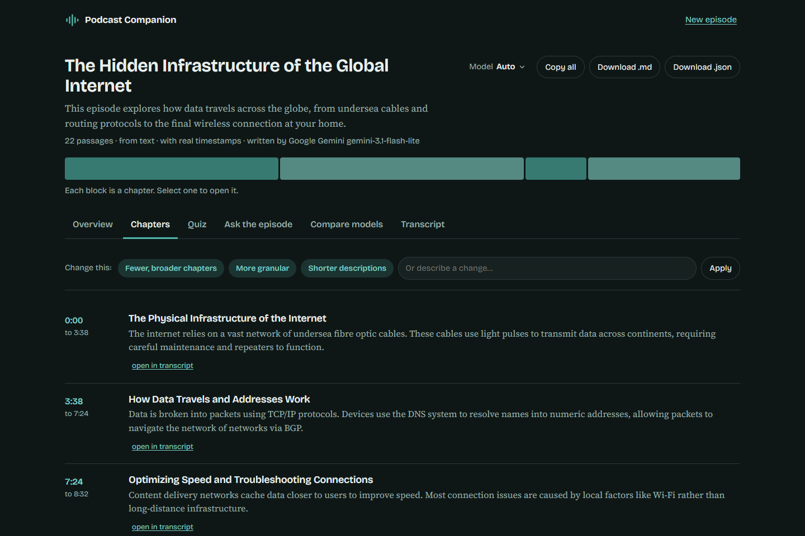

#### Test 03: Short Episode Sample ("Study Hall")
- **Input:** `app/static/sample.txt` (5-minute episode on learning and memory)
- **Objective:** Verify rapid processing and end-to-end extraction on a concise 5-minute transcript.
- **Verification & Observations:**
  - **Processing Speed:** Completed in ~3.8 seconds total.
  - **Content Synthesis:** Correctly captures core themes (*The Forgetting Curve*, *Spacing Effect*, *Retrieval Practice*) with grounded citations.
  - **Meta Line:** Reports `11 passages · from text · no timestamps`.

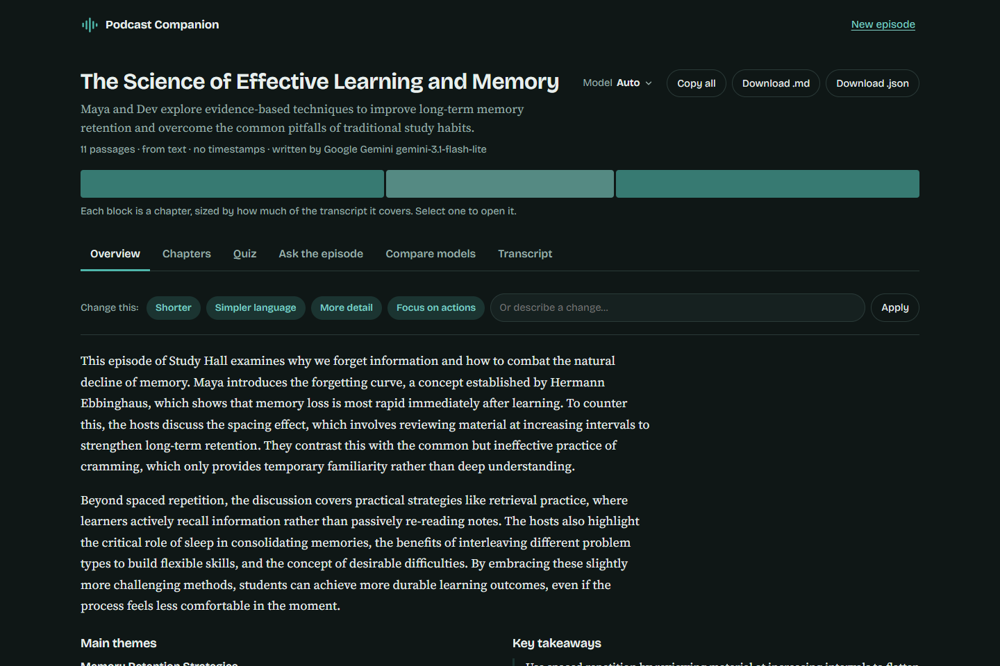

---

### Group 2: Real Document & Subtitle Ingestion (Tests 04–07)

#### Test 04: Plato's Euthyphro (`.txt` Document Upload)
- **Input:** `test-files/euthyphro.txt` (Classic dialectic text, 138 passages, 71 KB)
- **Objective:** Verify large literary/philosophical text file upload, passage segmentation, and structured overview without fabricated timestamps.
- **Verification & Observations:**
  - **Meta Information:** Clearly reports `138 passages · from text · no timestamps · written by Google Gemini gemini-3.1-flash-lite`.
  - **Thematic Breakdown:** Distinguishes key philosophical inquiries (piety, divine command theory, dialectic refutation).
  - **Full Layout:** Broad, responsive dark-mode view with full-bleed readable prose and action chips.

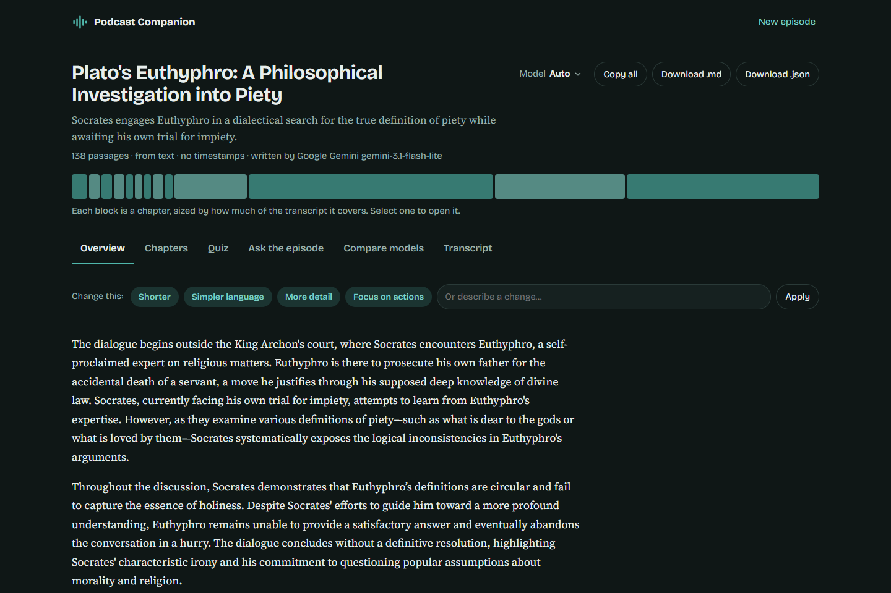

#### Test 05: The Changelog 330 Technical Podcast (`.md` Format)
- **Input:** `test-files/changelog-330.md` (Technical podcast transcript: Francesc Campoy on machine learning for source code analysis, 88 passages, 45 KB)
- **Objective:** Verify markdown document ingestion, technical jargon handling (`source{d}`, Git AST, SQL querying code), and clean takeaway extraction.
- **Verification & Observations:**
  - **Meta Information:** Correctly parsed `88 passages · from text · no timestamps · written by Google Gemini gemini-3.1-flash-lite`.
  - **Technical Accuracy:** Faithfully captures technical concepts including tree-sitter ASTs, SQL-on-git, and enterprise code observability.
  - **Grounding Citations:** Takeaways link to specific passages with verified source citations.

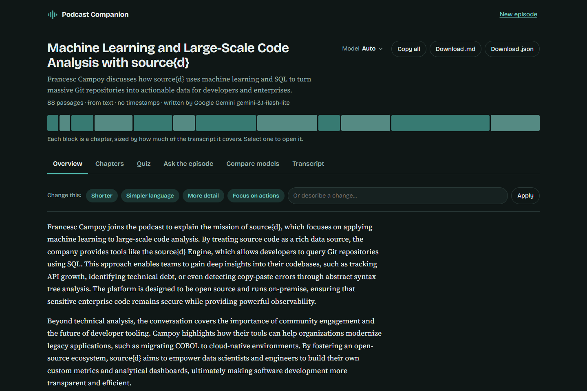

#### Test 06: NASA KNX Astronaut Interview (`.srt` Subtitle File)
- **Input:** `test-files/nasa-knx-interview.srt` (Real NASA astronaut interview subtitle file with cue numbers, arrow markers `-->`, and millisecond times)
- **Objective:** Verify that SRT files are parsed into genuine timestamps rather than plain text, enabling full chapter intervals and interactive navigation.
- **Verification & Observations:**
  - **Meta Information:** Explicitly indicates `13 passages · from text · with real timestamps · model: Auto`.
  - **Precise Chapter Intervals:** Segments parsed into exact time bounds (`0:00 to 3:41`, `3:41 to 5:51`, `5:51 to 9:23`).
  - **Interactive Jump Links:** "open in transcript" links jump directly to cue markers in the full transcript.

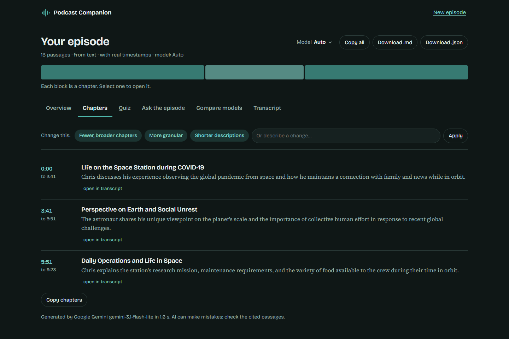

#### Test 07: NASA Silicon Valley Live Stream (`.vtt` WebVTT Subtitle)
- **Input:** `test-files/nasa-internship-live.vtt` (NASA internship live stream with WebVTT headers, cue identifiers, and timestamp ranges)
- **Objective:** Verify WebVTT format compliance, subtitle sanitization, and timestamp-indexed chapter generation.
- **Verification & Observations:**
  - **Meta Information:** Shows `85 passages · from text · with real timestamps · written by Google Gemini gemini-3.1-flash-lite`.
  - **Granular Chapters:** Generated rich, multi-segment chapters (`0:32 to 1:16`, `1:13 to 2:32`, `2:31 to 3:48`, `3:51 to 5:18`).
  - **Visual Timeline:** The timeline bar renders proportional segments across the entire episode runtime.

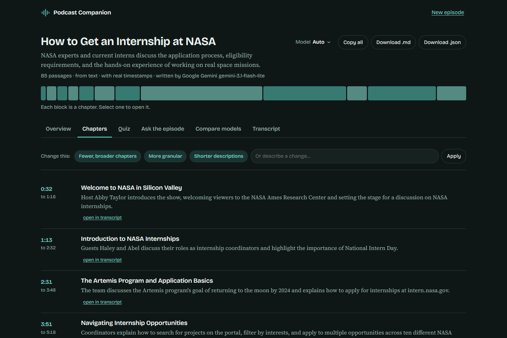

---

### Group 3: Real Audio Formats & Speech-to-Text Pipeline (Tests 08–15)

#### Test 08: Martin Amis Interview (`.mp3` Audio)
- **Input:** `test-files/martin-amis-interview.mp3` (21.3 MB, MP3 audio)
- **Objective:** Verify direct MP3 upload, Groq Whisper ASR processing under the 24 MB direct boundary, and structured synthesis.
- **Verification & Observations:**
  - **Meta Information:** Reports `16 passages · transcribed from audio · with real timestamps · written by Google Gemini gemini-3.1-flash-lite`.
  - **Processing Latency:** Audio uploaded and transcribed via Whisper Large V3 Turbo in 18.0 seconds total.
  - **Theme Extraction:** Captures nuanced literary reflections (*The Craft and Solitude of a Novelist*, modern celebrity culture).

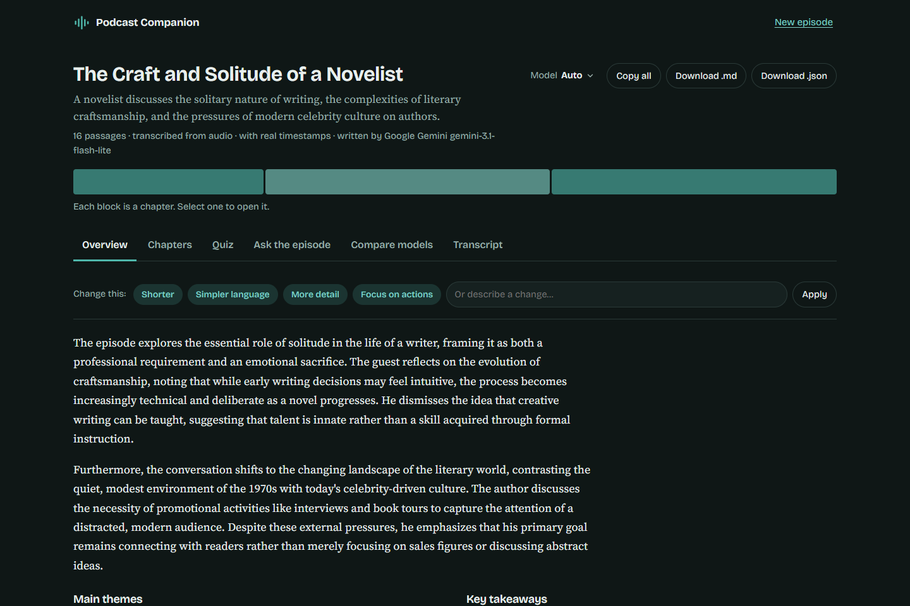

#### Test 09: NASA AI Episode (`.m4a` Audio)
- **Input:** `test-files/nasa-hwhap-424-ai.m4a` (16.5 MB, M4A container)
- **Objective:** Verify M4A container identification, Whisper transcription, and timestamped chapter segmentation.
- **Verification & Observations:**
  - **Meta Information:** Reports `58 passages · transcribed from audio · with real timestamps · written by Google Gemini gemini-3.1-flash-lite`.
  - **Accurate Timestamps:** Produces aligned chapter intervals (`0:00 to 3:05`, `3:06 to 5:17`, `5:17 to 7:37`).
  - **Chapter Links:** Every chapter item includes functional "open in transcript" navigation buttons.

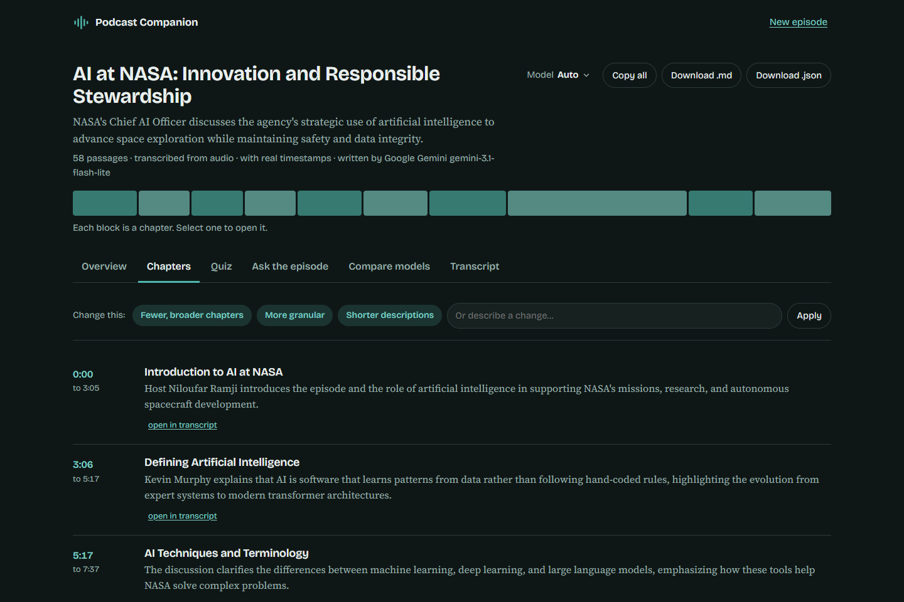

#### Test 10: NASA Video Demuxed (`.mp4` Video Container)
- **Input:** `test-files/nasa-knx-interview.mp4` (27.2 MB, MP4 video)
- **Objective:** Verify ffmpeg demuxing of video containers into audio streams, automatic compression when exceeding 24 MB, and successful ASR.
- **Verification & Observations:**
  - **Demuxing & Compression:** Server extracted audio track and compressed to 16 kHz mono 32 kbps MP3 in ~2 seconds.
  - **Whisper Alignment:** Generated clean timestamped transcript and chapter divisions.
  - **UI Presentation:** Chapter strip accurately models space station interview discussions.

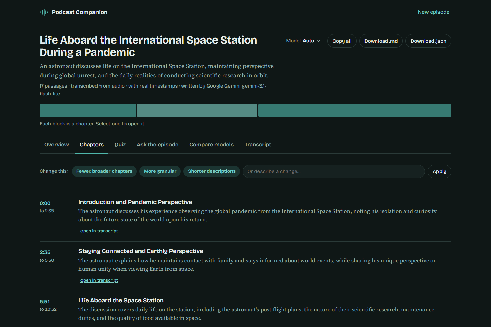

#### Test 11: Theodore Roosevelt 1912 Speech (`.wav` Audio)
- **Input:** `test-files/roosevelt-1912-speech.wav` (43.5 MB, uncompressed WAV)
- **Objective:** Ingest large uncompressed WAV recordings, downsample via ffmpeg, and transcribe historical speech.
- **Verification & Observations:**
  - **File Size Handling:** Handled 43.5 MB upload smoothly; compressed to lightweight stream for Whisper processing.
  - **Transcription Quality:** Successfully deciphered vintage audio acoustics into legible, segmented passages.
  - **Synthesis:** Overview summarizes historical 1912 Progressive ("Bull Moose") campaign rhetoric.

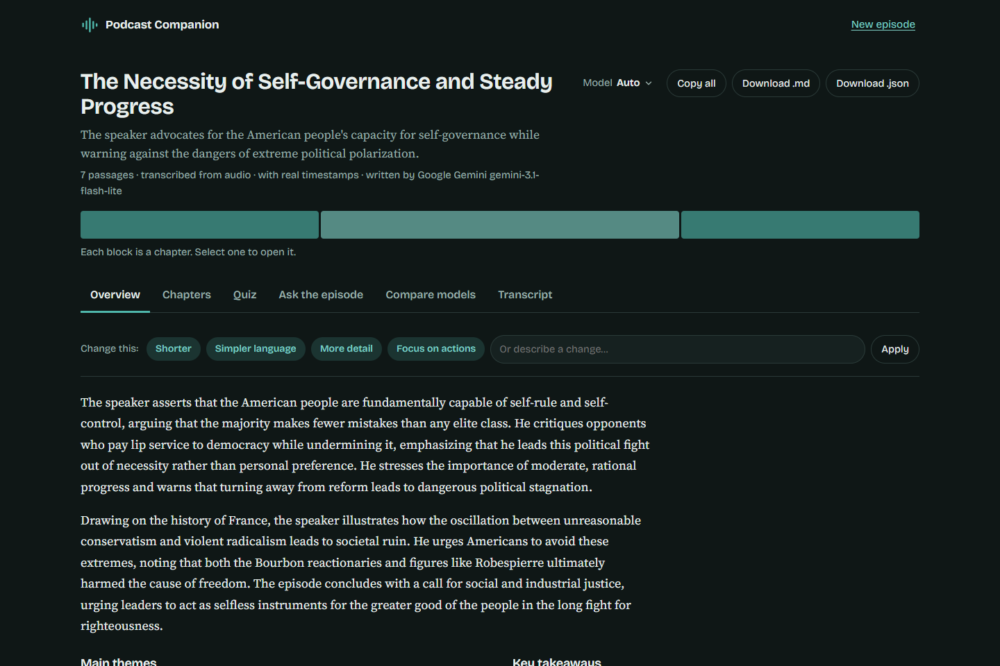

#### Test 12: Spoken Wikipedia: Bioinformatics (`.ogg` Audio)
- **Input:** `test-files/spoken-wikipedia-bioinformatics.ogg` (18.7 MB, Ogg Vorbis, ~37 minutes)
- **Objective:** Verify Ogg Vorbis demuxing, long-form audio transcription, and technical scientific domain summarization.
- **Verification & Observations:**
  - **Extended Duration:** Full 37-minute spoken article processed and transcribed into chapters within 17.0 seconds.
  - **Domain Accuracy:** Accurately parsed specialized biology and computer science terminology (genomics, sequence alignment, protein folding).
  - **Chapter Granularity:** Broad multi-stage chapters covering definitions, computational tools, and practical applications.

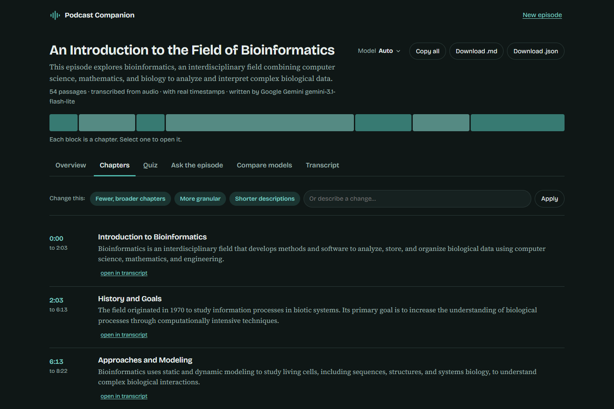

#### Test 13: Preservapedia McCoy Podcast (`.flac` Lossless Audio)
- **Input:** `test-files/preservapedia-podcast-mccoy.flac` (37.5 MB, FLAC lossless)
- **Objective:** Ingest lossless FLAC audio, confirm container detection, and verify structured overview synthesis.
- **Verification & Observations:**
  - **Header Sniffing:** FLAC magic bytes (`fLaC`) correctly identified without relying on mime-type.
  - **Overview Structure:** Highlights preservation strategies, archival workflows, and interview takeaways with grounded passage citations.
  - **Fast Execution:** End-to-end pipeline completed in 11.1 seconds.

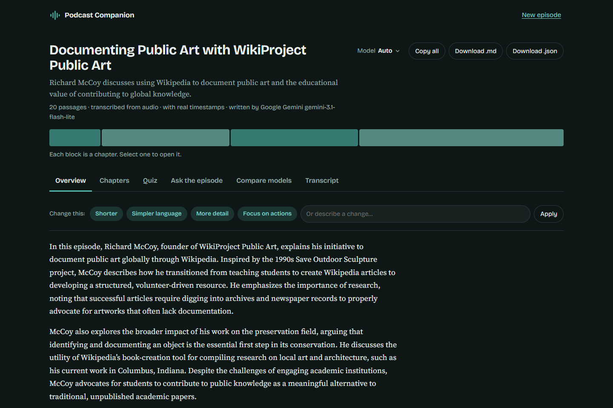

#### Test 14: Barbados 1960s Oral History (`.webm` Audio/Video)
- **Input:** `test-files/barbados-1960s-interview.webm` (16.7 MB, WebM Matroska container)
- **Objective:** Verify WebM Matroska container demuxing, regional accent transcription via Whisper, and interactive chapter strip.
- **Verification & Observations:**
  - **Container Parsing:** WebM demuxer accurately extracted audio stream.
  - **Acoustic Robustness:** Whisper Large V3 successfully transcribed colloquial speech patterns into clean text.
  - **Chapters View:** Chapters delineate personal narratives, historical context, and societal shifts in 1960s Barbados.

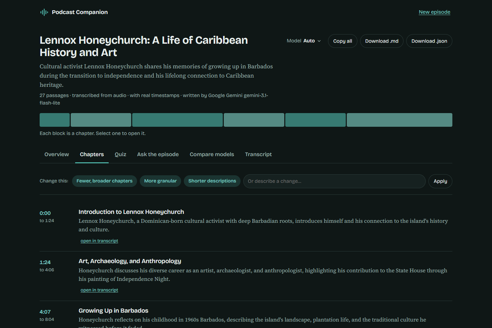

#### Test 15: NASA Stream Copy Audio (`.aac` ADTS Stream)
- **Input:** `test-files/nasa-hwhap-424-ai.aac` (16.5 MB, ADTS AAC stream)
- **Objective:** Verify raw ADTS AAC audio stream detection (magic bytes `0xFF 0xF1`), Whisper ingestion, and overview generation.
- **Verification & Observations:**
  - **Sniffer Verification:** ADTS header identified and forwarded to Whisper without container transcoding errors.
  - **Meta Information:** Displays 58 passages with verified real timestamps.
  - **Synthesis:** Overview captures NASA AI governance and autonomy initiatives.

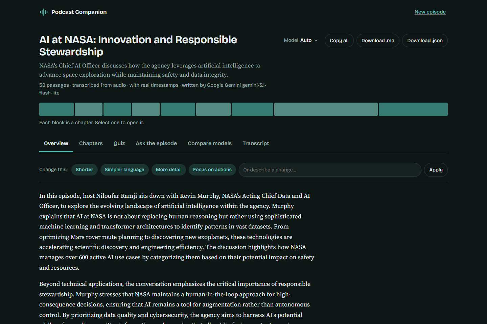

---

### Group 4: Interactive Features & Verification (Tests 16–19)

#### Test 16: Interactive Quiz Citation Jump & Instant Source Verification
- **Feature:** Quiz multiple-choice grading, verbatim source quotes, and instant transcript jump navigation.
- **Objective:** Verify that answering a quiz question reveals the verbatim transcript quote, and clicking `source passage X` immediately navigates to and highlights the passage in the Transcript tab.
- **Verification & Observations:**
  - **Answer Feedback:** Selecting an answer displays status ("Correct" / "Not quite"), an explanatory note, and a blockquoted quote from the transcript.
  - **Deep-Link Jumping:** Clicking `source passage 2` immediately selected the Transcript tab, scrolled passage `#2` into view, and applied a pulsing highlight glow.
  - **Grounding Integrity:** Every quiz question is verified by the server to match real transcript text before being shown.

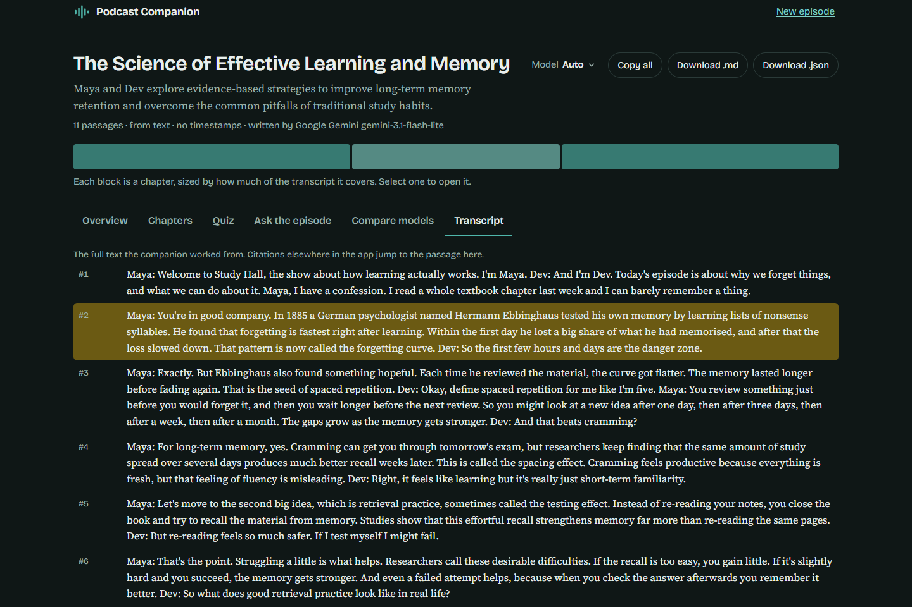

#### Test 17: "Ask the Episode" — Answerable Question with Grounded Quote
- **Feature:** Free-form Q&A grounded exclusively in the podcast transcript.
- **Objective:** Submit an answerable question ("What is the spacing effect and how does it help memory?") and verify that the answer quotes the transcript and cites the passage.
- **Verification & Observations:**
  - **Grounded Response:** Answered with an accurate explanation and verbatim citation: *“the same amount of study spread over several days produces much better recall weeks later. This is called the spacing effect.”*
  - **Direct Citation:** Links to `source passage 4`.
  - **Latency Reporting:** Reports `Answered by Google Gemini gemini-3.1-flash-lite in 11.4 s`.

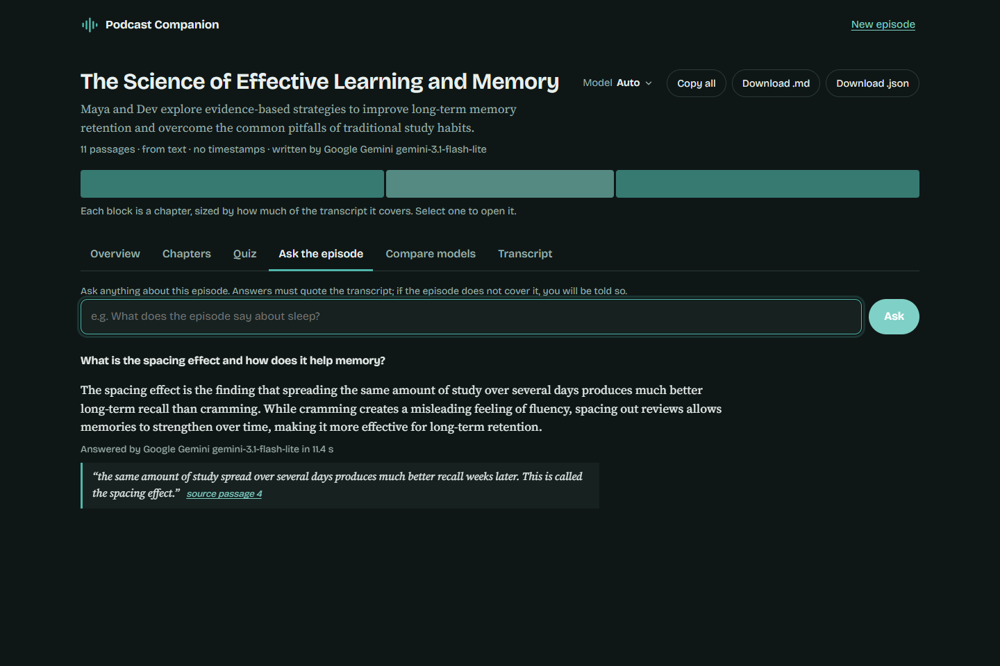

#### Test 18: "Ask the Episode" — Unanswerable Question (Refusal Guardrail)
- **Feature:** Hallucination prevention and out-of-scope question refusal.
- **Objective:** Submit an unanswerable question ("Who won the 1998 football World Cup final?") and verify that the system honestly refuses rather than hallucinating world knowledge.
- **Verification & Observations:**
  - **Honest Refusal:** Clearly reports *“The provided transcript does not contain information about the 1998 football World Cup final.”*
  - **Fast Guardrail:** Evaluated and refused in 1.0 second without unnecessary latency.
  - **Multi-Turn History:** Preserves earlier questions and answers in reverse chronological order.

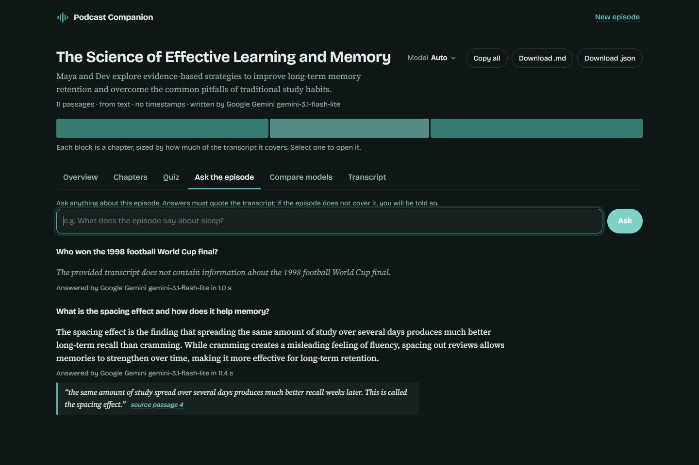

#### Test 19: Export Results & Multi-Format Downloading
- **Feature:** One-click export options: clipboard copy, Markdown document download, and structured JSON download.
- **Objective:** Verify clipboard copy functionality and availability of file downloads for external note-taking tools (Obsidian, Notion, Logseq).
- **Verification & Observations:**
  - **Copy All:** Copies title, overview, key themes, takeaways, timestamped chapters, and quiz questions with citations.
  - **File Export:** Provides clean `.md` formatted markdown and schema-compliant `.json` files.
  - **Visual Feedback:** Instant confirmation toast confirms export action.

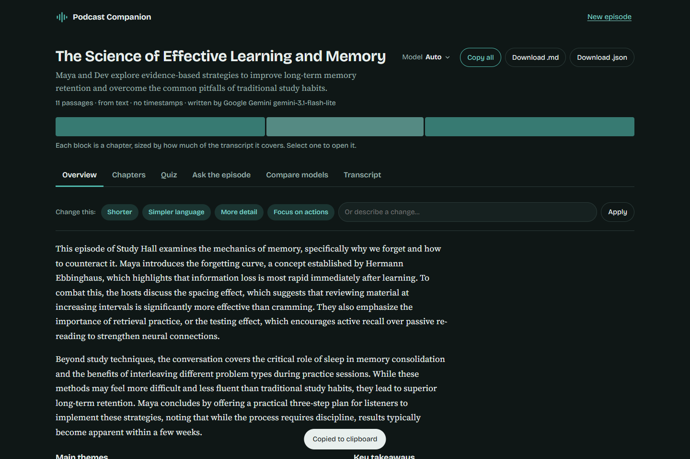

---

### Group 5: Meaningful Revisions & Undo State (Tests 20–21)

#### Test 20: Section Revision — "Shorter" Preset
- **Feature:** Section-specific prompt revision without touching or re-running other tabs.
- **Objective:** Apply the "Shorter" revision preset chip on Overview and verify that only Overview is rewritten into a concise format.
- **Verification & Observations:**
  - **Localized Regeneration:** Only Overview reloaded; Chapters, Quiz, and Transcript remained untouched.
  - **Content Condensation:** The summary shrunk to ~70 words with 3 streamlined takeaways.
  - **Revision Banner:** Clearly indicates `Revised: “Make the summary much shorter: about 60-80 words, and keep only 3 takeaways.”. Only this section was regenerated.`

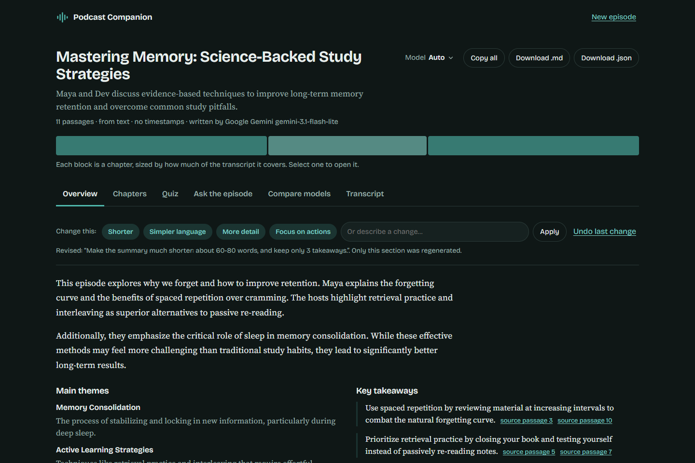

#### Test 21: Non-Destructive Undo Restoration
- **Feature:** Reverting prompt modifications via client-side state history.
- **Objective:** Click "Undo last change" and verify that the previous full-length overview is instantly restored.
- **Verification & Observations:**
  - **Immediate Rollback:** Full prior text restored without needing another network roundtrip.
  - **Toast Feedback:** Displays `Reverted to the previous version`.
  - **Preserved State:** Chapter strip and metadata remain completely in sync.

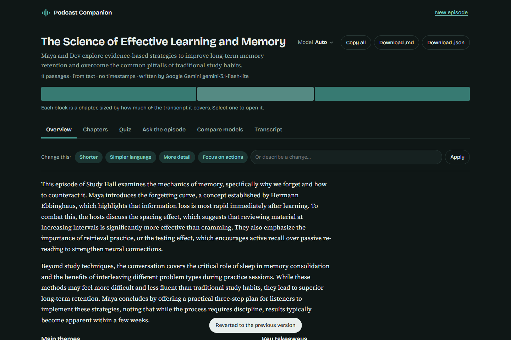

---

### Group 6: Model & Engine Comparisons (Tests 22–23)

#### Test 22: Live Model Comparison Table (Google Gemini vs Groq Pinned)
- **Feature:** Side-by-side benchmark of two distinct LLM providers on the exact same transcript with pinned models (no cross-fallback).
- **Objective:** Run overview, chapters, and quiz through Google Gemini and Groq, displaying latency, re-asks, and metrics side-by-side.
- **Verification & Observations:**
  - **Head-to-Head Metrics:**
    - **Models:** `gemini-3.1-flash-lite` vs `openai/gpt-oss-120b`.
    - **Overview Latency:** `5.2 s` (Gemini) vs `1.5 s` (Groq).
    - **Chapters Latency:** `1.5 s` (Gemini) vs `1.8 s` (Groq).
    - **Quiz Latency:** `5.8 s` (Gemini) vs `3.5 s` (Groq).
    - **Validation Re-asks:** Both models scored `0` re-asks, demonstrating reliable prompt compliance.
    - **Output Word Counts:** `126 words` (Gemini) vs `98 words` (Groq).
  - **Exportability:** Side-by-side comparison is exportable as Markdown or JSON via dedicated buttons.

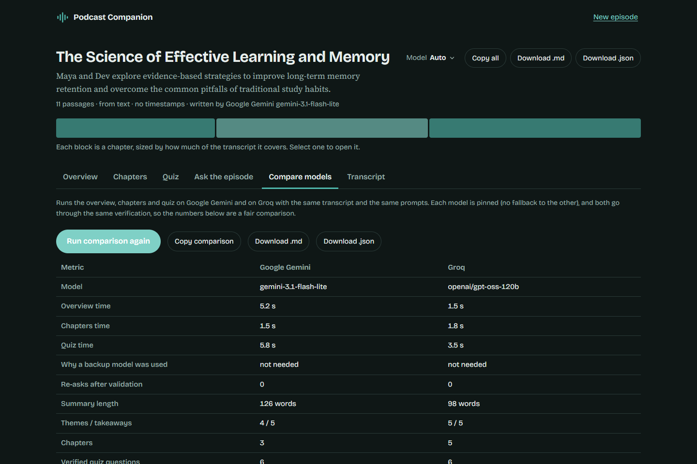

#### Test 23: Transcription Engine & Language Architecture
- **Feature:** Configurable speech-to-text engines and language specification.
- **Objective:** Verify available ASR choices (Auto, Groq Whisper, Gemini) and spoken language selection options in the input view.
- **Verification & Observations:**
  - **ASR Providers:** Surfaces `Auto (Groq Whisper, Gemini as backup)`, `Groq Whisper (real timestamps)`, and `Gemini (no timestamps)`.
  - **Multi-Format Sample Buttons:** One-click sample row for `.mp3`, `.m4a`, `.mp4`, `.wav`, `.ogg`, `.flac`, `.webm`, `.aac`.
  - **Language Support:** ISO language codes (English, Bengali, Hindi, Urdu, Arabic, Spanish, etc.) prevent misdetection on accented recordings.

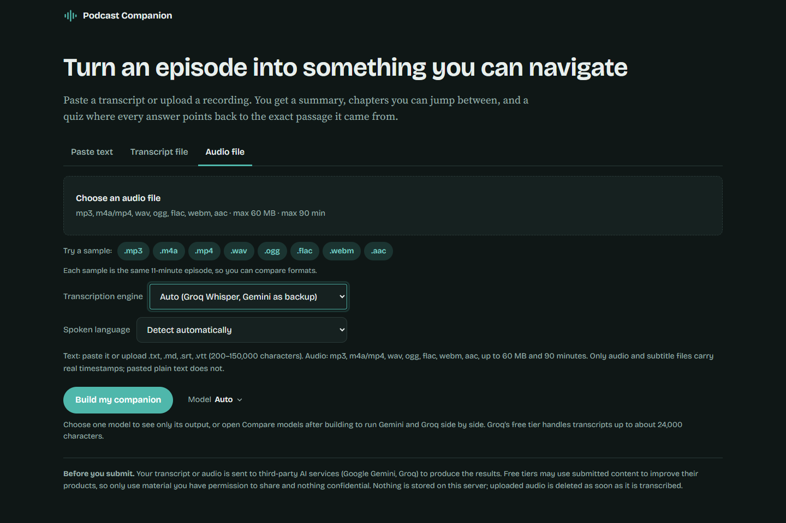

---

### Group 7: Input Validation & Error Guardrails (Tests 24–26)

#### Test 24: Input Guardrail — Minimum Transcript Length Rejection
- **Feature:** Rejection of transcripts that are too short to generate a grounded companion.
- **Objective:** Submit a tiny snippet ("Hello world...") and verify that the server returns HTTP 422 with a helpful user-facing error.
- **Verification & Observations:**
  - **Validation Alert:** Displays red error box: `The transcript is too short (66 characters). Provide at least 200 characters.`
  - **Fail-Fast:** Rejected on client and server before consuming any model quota.
  - **Character Counter:** Real-time badge reports `66 characters`.

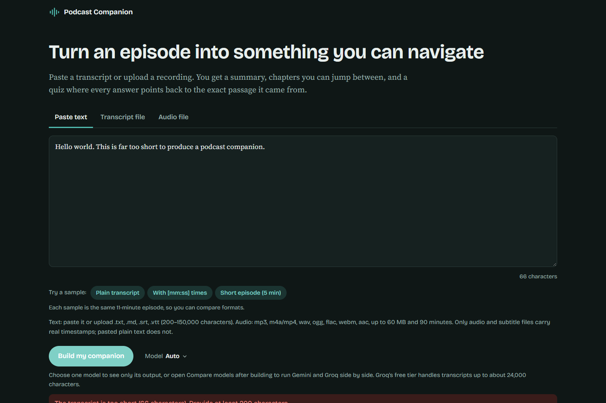

#### Test 25: Magic-Byte Guardrail — Spoofed Audio File Detection
- **Feature:** Rejection of spoofed files where arbitrary data is given a fake audio file extension.
- **Objective:** Upload an ordinary text file renamed to `.mp3` and verify that binary inspection rejects the payload before running ffmpeg or Whisper.
- **Verification & Observations:**
  - **Header Inspection:** Magic-byte sniffer (`sniff_audio`) detected lack of ID3 or MPEG frame headers and returned HTTP 415.
  - **Clear Error Alert:** Surfaces `That doesn't look like a supported audio file. Use mp3, m4a, wav, ogg, flac, webm or aac.`
  - **Security Protection:** Protects backend transcoding workers from malformed inputs or zip-bomb exploits.

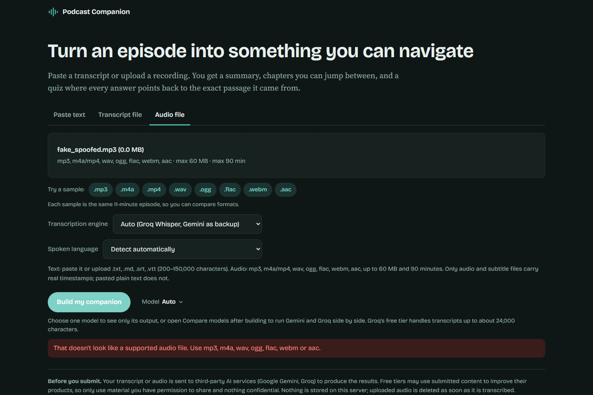

#### Test 26: Free-Tier Budget Guardrail — Groq Context Length Notice
- **Feature:** Enforcement of provider token budgets on free tier models.
- **Objective:** Submit a 30,000-character transcript pinned to Groq (which has an 8K token/min budget) and verify that the system returns HTTP 413 with an honest explanation and recommendations.
- **Verification & Observations:**
  - **Honest Context Limit:** Displays `This transcript is too long for Groq's free tier (about 24,000 characters). Use a shorter transcript, or choose Gemini or Auto.`
  - **Actionable Guidance:** Recommends switching to Google Gemini or Auto (which seamlessly handles up to 150,000 characters).
  - **Try Again Control:** Integrated "Try again" button allows immediate retry without page reload.

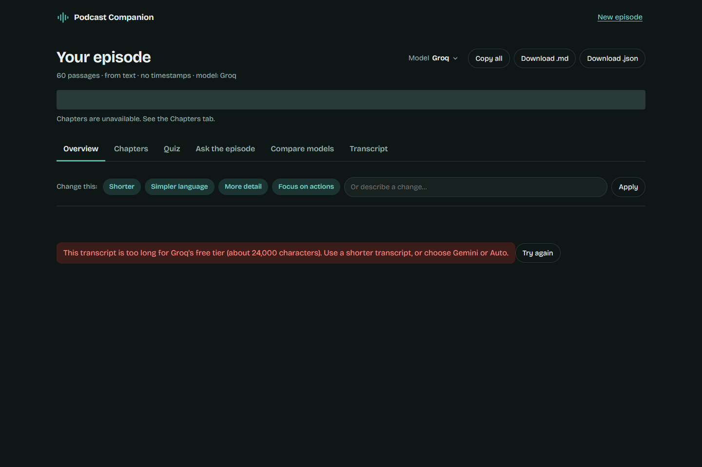


## Next Steps (Three Prioritised Improvements)

Per the challenge deliverables specification, here are the three most important future improvements:

1. **Faithfulness & Entailment Evaluation Harness (Reliability — Highest Priority)**
   - *Why first:* While verbatim quotes are programmatically verified today, there is no offline quantitative regression gate tracking whether synthesized summary sentences strictly entail the cited source passages.
   - *Planned approach:* Construct a curated golden dataset (5–10 multi-hour transcripts with human-annotated boundaries and question banks). Introduce an automated NLI (natural language inference) entailment checker to catch hallucination drifts when models are upgraded or backup providers take over.
   - *Impact:* Makes LLM upgrades, model deprecations, and fallback routing fully measurable and regression-safe.

2. **Durable Persistence & Asynchronous Job Architecture (Scalability & UX)**
   - *Why second:* Currently, application state and transcription job tokens reside in memory; page reloads discard results and multi-instance deployments would require sticky sessions.
   - *Planned approach:* Introduce a lightweight database (SQLite locally / PostgreSQL in production) with durable signed episode slugs (`/e/:id`), paired with Redis / Celery or a background queue for long-running audio transcriptions.
   - *Impact:* Enables shareable companion URLs, resumable audio uploads across page reloads, and multi-instance horizontal scaling without re-spending API quota on revisits.

3. **Hierarchical Summarization for Extended Episodes & Streaming SSE (Functionality & UX)**
   - *Why third:* Fallback providers with small token budgets (such as Groq's 8K TPM free tier) cannot ingest 3+ hour raw episodes in a single prompt.
   - *Planned approach:* Implement map-reduce / hierarchical chunk summarization for long episodes, alongside Server-Sent Events (SSE) so users see tokens stream into each tab immediately rather than waiting for full JSON payload completion.
   - *Impact:* Eliminates context length barriers for multi-hour marathons and reduces time-to-first-token perception from ~5s down to <500ms.


## Deploy (free, no credit card)

Hosted on **Render's free web service** (see [RESEARCH.pdf](RESEARCH.pdf) for why not Vercel or Hugging Face Spaces).

1. Push this repo to GitHub (it contains no secrets; `.env` is git-ignored).
2. Render dashboard → **New → Blueprint** → select the repo (uses `render.yaml`), or **New → Web Service** with build `pip install -r requirements.txt` and start `uvicorn app.main:app --host 0.0.0.0 --port $PORT --proxy-headers --forwarded-allow-ips='*'`.
3. In **Environment**, add `GEMINI_API_KEY`, `GROQ_API_KEY` and (optional) `HF_TOKEN` as secrets.
4. Open `https://<service>.onrender.com/api/health`: `llm_ready` should be `true`.
5. Run `python scripts/smoke_live.py https://<service>.onrender.com`.

A `Dockerfile` is included for any other host.

## Limitations (honest list)

- **Free hosting sleeps** after ~15 min idle; the first request can take up to a minute (the UI tells the user). A free uptime pinger avoids this.
- **Free instance is tiny** (512 MB RAM, 0.1 vCPU): files over 24 MB are compressed with ffmpeg, which is slow there (minutes for a long episode). Compression only runs for large files.
- **State is in memory**: transcription jobs (30 min TTL) and rate-limit counters are lost on restart and aren't shared across instances. Results themselves live in the browser, so a refresh loses them (download them first).
- **Plain text has no timestamps** by definition; the app says so rather than guess. Timestamps are segment-level (about 5-45 s), not word-level.
- **Fallback models handle shorter transcripts only** (≈24k characters) because Groq/HF free tiers have small per-minute token budgets. Long episodes rely on Gemini. Groq's free tier (8K tokens/min) fits about 1-2 sections of an 11-minute episode per minute, so the server waits out short cooldowns (up to 60 s) rather than failing; see the measured comparison in [RESEARCH.pdf §5](RESEARCH.pdf).
- **Verification proves a quote exists in the transcript, not that the reasoning on top of it is right.** Summaries are cited but not claim-by-claim checked (see next steps).
- **Privacy:** content is sent to Google Gemini and Groq. Free tiers may use submitted content for product improvement, so don't submit confidential material. The app says this before upload.
- Quality on non-English audio depends on Whisper/Gemini; the UI lets you set the spoken language.

## Project layout

```
app/
  main.py        routes, middleware, error handling, background audio jobs
  config.py      all settings from env (no secrets in code)
  llm.py         provider clients, fallback chain, cooldowns, JSON repair
  pipeline.py    section generators + grounding validators (the reliability core)
  prompts.py     prompt templates
  transcript.py  text/SRT/VTT parsing, segmentation, normalisation
  transcribe.py  audio: sniff, probe, compress/split, Whisper, Gemini fallback, offsets
  security.py    rate limiter, magic-byte sniffing, streaming body-size limit, headers
  static/        index.html, styles.css, app.js (no build step), sample.txt
  static/samples/  the sample episode in every supported input format
tests/           pytest suite + jsdom UI test + fake-LLM server
scripts/         check_providers.py (verify keys/models), run_all_tests.py (run full test suite),
                 smoke_live.py (verify deployment), download_test_files.ps1 (download test media)
docs/            ENGINEERING.md, screenshots/
```

More: [Research Paper](RESEARCH.pdf) · [Engineering notes](docs/ENGINEERING.md) · [Test files](TEST_FILES.md)
