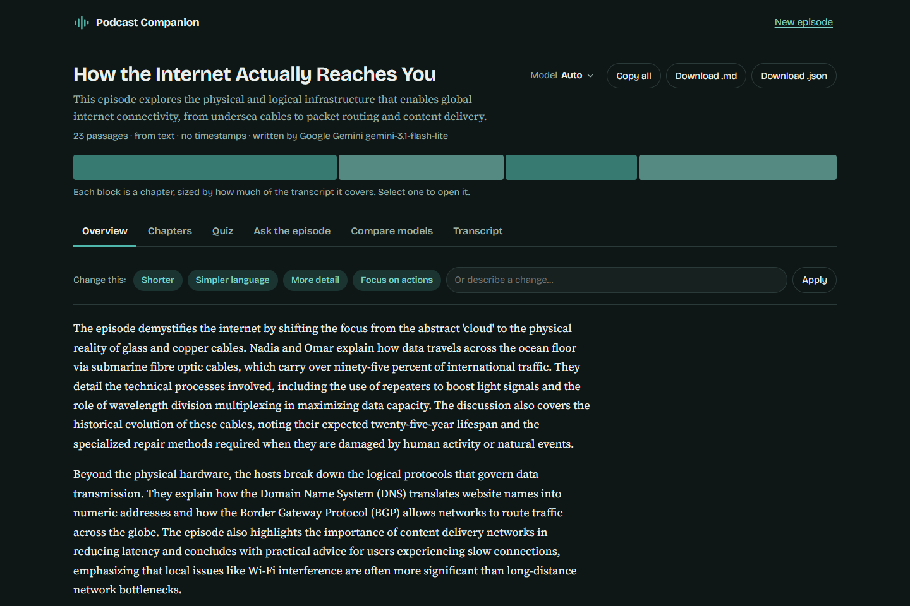

# Podcast Companion

Turn a podcast transcript or recording into an interactive companion: a structured **overview**, **chapters** you can jump between, a **quiz** whose answers are checked against the source, and an **"ask the episode"** box that refuses to answer what the episode doesn't cover.

**Live app:** [https://podcast-companion.onrender.com](https://podcast-companion.onrender.com) &nbsp;|&nbsp; **Demo video:** `<your-video-url>` &nbsp;|&nbsp; Built for the Thealon AI Engineering Challenge.

## What it does

| Requirement | How it's met |
|---|---|
| Provide content | Paste text, upload `.txt/.md/.srt/.vtt`, or upload audio (`mp3 m4a wav ogg flac webm aac`). Limits are shown in the UI and read from the server, so they can't drift. |
| Episode overview | Title, one-liner, ~150-word summary, 3-5 themes, 4-6 takeaways, each takeaway citing the passages that support it. |
| Navigable chapters | A clickable chapter strip plus chapter cards. **Timestamps are real or absent**: they come from Whisper / subtitle files, never from the model. Plain pasted text shows passage ranges and says why there are no times. |
| Interactive learning | Multiple-choice quiz with instant feedback, explanation, score, and the verbatim source quote (click to jump to it in the transcript). |
| Meaningful revision | Every section has one-click presets ("Shorter", "Simpler language", "More challenging"...) and a free-text box. **Only that section is regenerated**; the rest is untouched. Undo restores the previous version. |
| Usable result | Copy per section, copy all, download Markdown, download JSON. Accessible tabs, keyboard navigation, dark mode, mobile layout. |
| Compare two models | Choose **Auto**, **Google Gemini** or **Groq** before building (and switch on the results page). The **Compare models** tab runs both on the same transcript, each pinned with no cross-fallback, and shows latency, validation re-asks, verified quiz questions and the outputs side by side, exportable as .md/.json. Audio can also be transcribed by Groq Whisper or Gemini. |
| Sample inputs | Each input tab has a **Try a sample** row with one button per format it accepts: pasted text (plain, `[mm:ss]`), .txt, .md, .srt, .vtt, and mp3, m4a, mp4, wav, ogg, flac, webm, aac. All carry the same 11-minute episode and can be downloaded from `/samples/`. See [docs/TESTING.md](docs/TESTING.md). |

## How it stays trustworthy

The model proposes; deterministic code verifies.

- Every transcript is split into **numbered segments**. The model cites segment numbers and the server looks up timestamps, so timestamps can't be invented.
- Every quiz question needs a **verbatim quote**. The server checks it exists near the cited segment (case/punctuation-insensitive, Unicode-aware, tolerant of a dropped word). Unverifiable questions are discarded; if too few survive, the model is re-asked with the exact failures, then the next provider is tried.
- Takeaways must cite real segments, otherwise they are dropped.
- "Ask the episode" answers need a verified quote; otherwise the answer is downgraded to "I won't guess".
- The transcript is treated as untrusted data (prompt-injection hardening) and model output is rendered as text, never HTML.

## Quick start (local)

Requires Python 3.12+. No system ffmpeg needed (a static binary ships with the `imageio-ffmpeg` package).

```bash
git clone https://github.com/moazzem-hossain-majumder/Podcast-Companion.git && cd Podcast-Companion
python -m venv .venv && source .venv/bin/activate     # Windows: .venv\Scripts\activate
pip install -r requirements.txt
cp .env.example .env                                   # then add your keys (see below)
python scripts/check_providers.py                      # real call to every configured model: confirms keys + model IDs
uvicorn app.main:app --reload                          # open http://127.0.0.1:8000
```

**Configuration** (environment variables or `.env`; `.env` is git-ignored):

| Variable | Needed? | Purpose |
|---|---|---|
| `GEMINI_API_KEY` | one LLM key required | Primary generation model ([get a free key](https://aistudio.google.com/apikey)) |
| `GROQ_API_KEY` | recommended | Whisper audio transcription + fallback LLM ([console.groq.com/keys](https://console.groq.com/keys)) |
| `HF_TOKEN` | optional | Third fallback LLM via Hugging Face Inference Providers |
| `LLM_CHAIN` | optional | Model fallback order, e.g. `gemini:gemini-3.5-flash,groq:openai/gpt-oss-120b`. **Change this if a model is retired**; run `scripts/check_providers.py` to see which IDs your key can call. Vendor dates move (see [RESEARCH.md](docs/RESEARCH.md)). A provider that has a key but is missing here is still added at the end, so it stays selectable. |
| `MAX_AUDIO_MB`, `MAX_AUDIO_MINUTES`, `MAX_TRANSCRIPT_CHARS`, `RATE_LIMIT_PER_MINUTE` | optional | See `.env.example` |

Without any key the app still starts and clearly reports that AI generation isn't configured.

## Tests

**Real test files for every format:** [TEST_FILES.md](TEST_FILES.md), with a one-command download script (`scripts/download_test_files.ps1`).
**Manual testing guide:** [docs/TESTING.md](docs/TESTING.md) has links to a test file in every format, how to compare Gemini and Groq, and a checklist for verifying the output yourself.

```bash
pip install -r requirements-dev.txt
python -m pytest -q          # 126 tests: parsing, grounding, provider fallback + pinning, HTTP error mapping, audio pipeline with real ffmpeg, samples
```

Browser-level UI test (real `index.html` + `app.js` in jsdom against a live server with a fake LLM; no keys needed):

```bash
cd tests/e2e && npm init -y && npm i jsdom && cd ../..
python tests/e2e_server.py 8765 &      # then:
BASE=http://127.0.0.1:8765 node tests/e2e/ui.test.mjs
```

After deploying, run the live end-to-end check (also prints real latencies):

```bash
python scripts/smoke_live.py https://podcast-companion.onrender.com
```

## Test Execution Log & Visual Verification

Each test is independently executed and verified with detailed observations and full-resolution visual evidence:

### Test 01: Built-in Plain Text Sample (No Timestamps)
- **Input:** `app/static/samples/episode.txt` (Pasted text, 23 passages)
- **Objective:** Verify plain-text parsing and confirm that the application displays passage ranges and honestly reports absent timestamps rather than inventing fake ones.
- **Verification & Observations:**
  - **Meta Information:** Clearly reports `23 passages · from text · no timestamps · written by Google Gemini gemini-3.1-flash-lite`.
  - **Navigable Timeline:** Interactive chapter strip dynamically sizes blocks based on transcript coverage without fabricated times.
  - **Structured Overview:** Synthesizes the episode into readable prose, key themes, and takeaways with verifiable citations (`source passage 3`).
  - **Revision Interface:** Preset chips (*Shorter*, *Simpler language*, *More detail*, *Focus on actions*) and free-text revision input are active.



## Deploy (free, no credit card)

Hosted on **Render's free web service** (see [docs/RESEARCH.md](docs/RESEARCH.md) for why not Vercel or Hugging Face Spaces).

1. Push this repo to GitHub (it contains no secrets; `.env` is git-ignored).
2. Render dashboard → **New → Blueprint** → select the repo (uses `render.yaml`), or **New → Web Service** with build `pip install -r requirements.txt` and start `uvicorn app.main:app --host 0.0.0.0 --port $PORT --proxy-headers --forwarded-allow-ips='*'`.
3. In **Environment**, add `GEMINI_API_KEY`, `GROQ_API_KEY` and (optional) `HF_TOKEN` as secrets.
4. Open `https://<service>.onrender.com/api/health`: `llm_ready` should be `true`.
5. Run `python scripts/smoke_live.py https://<service>.onrender.com`.

A `Dockerfile` is included for any other host.

## Limitations (honest list)

- **Free hosting sleeps** after ~15 min idle; the first request can take up to a minute (the UI tells the user). A free uptime pinger avoids this.
- **Free instance is tiny** (512 MB RAM, 0.1 vCPU): files over 24 MB are compressed with ffmpeg, which is slow there (minutes for a long episode). Compression only runs for large files.
- **State is in memory**: transcription jobs (30 min TTL) and rate-limit counters are lost on restart and aren't shared across instances. Results themselves live in the browser, so a refresh loses them (download them first).
- **Plain text has no timestamps** by definition; the app says so rather than guess. Timestamps are segment-level (about 5-45 s), not word-level.
- **Fallback models handle shorter transcripts only** (≈24k characters) because Groq/HF free tiers have small per-minute token budgets. Long episodes rely on Gemini. Groq's free tier (8K tokens/min) fits about 1-2 sections of an 11-minute episode per minute, so the server waits out short cooldowns (up to 60 s) rather than failing; see the measured comparison in [docs/RESEARCH.md §6](docs/RESEARCH.md).
- **Verification proves a quote exists in the transcript, not that the reasoning on top of it is right.** Summaries are cited but not claim-by-claim checked (see next steps).
- **Privacy:** content is sent to Google Gemini and Groq. Free tiers may use submitted content for product improvement, so don't submit confidential material. The app says this before upload.
- Quality on non-English audio depends on Whisper/Gemini; the UI lets you set the spoken language.

## Project layout

```
app/
  main.py        routes, middleware, error handling, background audio jobs
  config.py      all settings from env (no secrets in code)
  llm.py         provider clients, fallback chain, cooldowns, JSON repair
  pipeline.py    section generators + grounding validators (the reliability core)
  prompts.py     prompt templates
  transcript.py  text/SRT/VTT parsing, segmentation, normalisation
  transcribe.py  audio: sniff, probe, compress/split, Whisper, Gemini fallback, offsets
  security.py    rate limiter, magic-byte sniffing, streaming body-size limit, headers
  static/        index.html, styles.css, app.js (no build step), sample.txt
  static/samples/  the sample episode in every supported input format (generated by scripts/make_samples.py)
tests/           pytest suite + jsdom UI test + fake-LLM server
scripts/         check_providers.py (verify keys/models), smoke_live.py (verify deployment),
                 make_samples.py + sample_episode.py (rebuild the sample files; needs espeak-ng + ffmpeg)
docs/            RESEARCH.md, ENGINEERING.md, DEMO_SCRIPT.md, CODE_TOUR.md, TESTING.md
```

More: [Research & comparison](docs/RESEARCH.md) · [Engineering notes](docs/ENGINEERING.md) · [Testing guide](docs/TESTING.md) · [Demo script](docs/DEMO_SCRIPT.md) · [Code tour](docs/CODE_TOUR.md)
