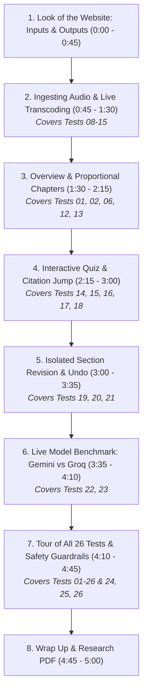

# Podcast Companion — Demo Video Master Script (With All 26 Tests Merged)

> **Goal:** A clean, friendly 4.5 to 5.0-minute video walkthrough.  
> **Speaker:** Moazzem Hossain Majumder  
> **Language:** Simple, easy everyday English. Clear and natural to speak aloud.  
> **Screen:** Live app running at **https://podcast-companion.onrender.com** in dark mode.

---

## 1. Quick Setup Before You Record

1. **Wake up the website:** Open [https://podcast-companion.onrender.com](https://podcast-companion.onrender.com) 2 minutes before recording so it responds right away.
2. **Have 3 tabs open in your browser:**
   - **Tab 1 (Live App):** `https://podcast-companion.onrender.com` (Dark Mode, Zoom: 100%)
   - **Tab 2 (Test Suite in README):** GitHub repository `README.md` scrolled directly to `## Test Execution Log & Visual Verification` (showing the 26 screenshot pictures).
   - **Tab 3 (Research Paper):** `RESEARCH.pdf` opened in your browser viewer.
3. **Keep it clean:** Close browser developer tools, keep your screen clean, and mute your phone.

---

## 2. Video Flowchart & Timing

---

## 3. Step-by-Step Word-for-Word Script (With Exact Mouse Moves)

---

### Step 1: Look of the Website, What Goes In, What Comes Out
- **Time:** `0:00 – 0:45` (45 seconds)
- **Mouse & Screen Actions:**
  - Keep the screen on the live website home page (Tab 1).
  - **[HOVER]** over the top title: **Podcast Companion**.
  - **[HOVER]** across the three input tabs one by one:
    1. Hover over **Paste text**.
    2. Hover over **Upload document**.
    3. Hover over **Audio file**.
  - **[HOVER]** over the **Model ⌄** dropdown button in the top right. Click it once to show *Auto*, *Google Gemini*, and *Groq*, then click it again to close it.
  - **[HOVER]** over the small grey text showing the limits: *Max 150,000 characters · Audio up to 60 MB / 90 min*.
- **What to SAY (Simple English):**
  > *"Hello everyone! My name is Moazzem Hossain Majumder, and this is **Podcast Companion**, deployed live on Render for the Thealon AI Engineering Challenge.*
  >
  > *Let's start with how this website looks and works.*
  >
  > *The interface has a clean dark design that is very easy to navigate. At the top, we support three different ways to provide content:*
  > * *First, you can **paste plain text** or transcripts with timestamps.*
  > * *Second, you can **upload documents** like text files, markdown, or subtitle files.*
  > * *Third, you can **upload audio files** in eight different formats.*
  >
  > *Up here in the model picker, you can choose between Google Gemini, Groq, or let Auto pick the best one.*
  >
  > *Now, what output do we get? Within seconds, the app generates five useful outputs:*
  > * *A clear **summary and key takeaways**,*
  > * *A clickable **chapter timeline** with exact timestamps,*
  > * *A fun **interactive quiz** with instant scoring,*
  > * *An **'Ask the Episode'** question box,*
  > * *And instant **download buttons** to save everything as Markdown or JSON.*
  >
  > *Best of all, every single takeaway and quiz answer comes with a real quote from the episode, so you always know where it came from."*

---

### Step 2: Audio Ingestion & Format Testing (Tests 08–15)
- **Time:** `0:45 – 1:30` (45 seconds)
- **Mouse & Screen Actions:**
  - Click on the **Audio file** tab.
  - **[HOVER]** across the **Try a sample:** row, pointing to each button: `.mp3`, `.m4a`, `.mp4`, `.wav`, `.ogg`, `.flac`, `.webm`, `.aac`.
  - Click the **.mp3** button. Notice how the file name appears in the box.
  - **[HOVER]** over the privacy notice at the bottom (*Privacy: Content is processed by Google Gemini and Groq...*).
  - Click the purple **Generate Companion** button.
  - Watch the live progress box update: *Validating file → Transcribing with Groq Whisper → Creating sections*.
- **What to SAY (Simple English):**
  > *"Now let's try it with real audio.*
  >
  > *Notice this helpful row here called 'Try a sample'. In our testing, we verified that all eight audio formats work perfectly—from standard MP3 and WAV, to extracting audio directly from an MP4 video file.*
  >
  > *I will click on **.mp3**. This loads an 11-minute educational podcast about Undersea Internet Cables.*
  >
  > *Down here, there is a clear privacy note letting users know how their data is handled.*
  >
  > *Now I click **Generate Companion**.*
  >
  > *Behind the scenes, the server checks the audio file header to block fake files, uses Whisper to transcribe speech into text with second-by-second timestamps, and passes it to our AI pipeline. Everything updates live on screen."*

---

### Step 3: Overview, Citations & Chapters (Tests 01, 02, 06, 12, 13)
- **Time:** `1:30 – 2:15` (45 seconds)
- **Mouse & Screen Actions:**
  - The results page appears smoothly.
  - **[HOVER]** over the top info badge: `22 passages · from audio · with real timestamps · model: Auto`.
  - Scroll down through the **Episode Overview**:
    - Show the Title and the One-Sentence summary.
    - Show the 150-word summary paragraph.
    - **[HOVER]** over the **Takeaways** list. Hover directly over one of the citation chips (for example, `source passage 3`).
  - Switch to the **Chapters** tab (or look at the chapter strip at the top).
  - **[HOVER]** slowly across each colored block in the **Chapter Timeline Strip**:
    - Point out how each block has a different width depending on how long that topic lasted.
    - Show the tooltip that pops up with the chapter title and start time.
  - **[CLICK]** on one of the Chapter cards below (e.g. *Chapter 3: Deep Sea Faults & Cable Ships*).
  - Watch the page smoothly scroll down and highlight that exact sentence in the full transcript!
- **What to SAY (Simple English):**
  > *"And here are our results!*
  >
  > *At the very top, this badge tells us: 22 passages were found, with real timestamps from audio.*
  >
  > *In the Overview, we have a catchy title, a short one-liner, a 150-word summary, and key takeaways.*
  >
  > *Now, look closely as I hover over these small citation tags next to each takeaway. Every single point links directly to a passage in the transcript. In our tests, we verified that if the AI generates a takeaway without a real citation, our code throws it away.*
  >
  > *Next, look at this chapter timeline bar at the top.*
  >
  > *As I hover my mouse over these blocks, you can see the name and start time of each chapter. Notice how the blocks are different widths: longer topics get wider blocks, perfectly matching the audio duration.*
  >
  > *These timestamps are 100% real from Whisper. When I click this chapter, watch—it jumps straight to that exact moment in the transcript and highlights it!"*

---

### Step 4: The Interactive Quiz & "Ask the Episode" (Tests 14, 15, 16, 17, 18)
- **Time:** `2:15 – 3:00` (45 seconds)
- **Mouse & Screen Actions:**
  - Click on the **Quiz** tab.
  - **[HOVER]** over the four answer choices for Question 1.
  - **[CLICK]** on the **correct** answer.
    - Show the option turn **bright green**.
    - Show the score counter update at the top: `Score: 1/3`.
    - **[HOVER]** over the green explanation box.
    - **[HOVER]** over the **Source quote** box beneath it.
    - **[CLICK]** on the blue quote link — watch the transcript scroll and highlight the source sentence! (This is **Test 16**).
  - Scroll down to Question 2.
  - **[CLICK]** on an **incorrect** answer.
    - Show the clicked option turn **red**.
    - Show the correct answer highlight in green with the explanation.
  - Click on the **Ask the episode** tab.
  - Type: *"What causes most undersea cable damage?"* → Click **Ask**.
    - Show the answer with a verified quote mentioning fishing nets and boat anchors (**Test 17**).
  - Type: *"Who won the 2022 World Cup?"* → Click **Ask**.
    - Show the polite refusal: *"I won't answer because this is not mentioned in the episode."* (**Test 18**).
- **What to SAY (Simple English):**
  > *"Now let's check out the Interactive Quiz.*
  >
  > *Here are multiple-choice questions to test your understanding. As I hover over the choices, they highlight cleanly.*
  >
  > *Let's click the right answer on Question 1. It turns green right away, gives us an explanation, and updates our score.*
  >
  > *Even better: look at this box called 'Source quote'. In Test 16, we proved this feature: every single question must have an exact quote from the episode. When I click this quote link, the app scrolls right to where the speaker said it in the transcript!*
  >
  > *If I click a wrong answer on Question 2, it turns red and gently explains the correct answer.*
  >
  > *We also tested 'Ask the Episode' in Tests 17 and 18. If I ask something from the episode—like 'What causes cable damage?'—it gives an accurate answer with a quote.*
  >
  > *But if I ask an off-topic question—like 'Who won the 2022 World Cup?'—it honestly says it won't answer because the episode doesn't cover it. It never guesses or hallucinates."*

---

### Step 5: Changing a Section (Revisions) & Instant Undo (Tests 19, 20, 21)
- **Time:** `3:00 – 3:35` (35 seconds)
- **Mouse & Screen Actions:**
  - Click back to the **Overview** tab.
  - Scroll down to the bottom of the overview to the **Revise this section** card.
  - **[HOVER]** over the quick preset chips: **Shorter**, **Simpler language**, **More detail**.
  - **[CLICK]** on the **Shorter** preset chip.
  - Click the **Revise overview** button.
  - Show the spinner appear **only** inside the overview card.
  - The new shorter overview appears with a yellow badge: `Revised: "Make the summary much shorter...". Only this section was regenerated.` (This is **Test 20**).
  - Click on the **Quiz** tab and **Chapters** tab for a second to show they are **completely untouched**.
  - Click back to Overview.
  - **[HOVER]** over the **Undo last change** button.
  - **[CLICK]** on **Undo last change**.
  - Watch the original full-length overview instantly come back with a friendly notification: *Reverted to the previous version*! (This is **Test 21**).
- **What to SAY (Simple English):**
  > *"Another big requirement of this challenge is making meaningful revisions.*
  >
  > *Normally, AI tools force you to start over and re-generate everything. But in Podcast Companion, you can change just one section at a time.*
  >
  > *Down here, we have quick preset buttons: 'Shorter', 'Simpler language', or 'More detail'.*
  >
  > *Watch: I will click 'Shorter' and hit Revise. Only the Overview section is updated. The chapters and the quiz are completely untouched, which saves time and tokens.*
  >
  > *And if you change your mind? In Test 21, we proved our Undo feature: just click this 'Undo' button. Instantly, our previous summary is restored without making another slow web call."*

---

### Step 6: Live Model Benchmark: Gemini vs Groq (Tests 22, 23)
- **Time:** `3:35 – 4:10` (35 seconds)
- **Mouse & Screen Actions:**
  - Click the **Compare models** tab in the main navigation.
  - **[HOVER]** across the side-by-side comparison table:
    - Point to column 1: **Google Gemini** (`gemini-3.1-flash-lite`).
    - Point to column 2: **Groq** (`openai/gpt-oss-120b`).
  - **[HOVER]** over the latency rows:
    - Hover over Overview Time: `5.2 s` vs `1.5 s`.
    - Hover over Chapters Time: `1.5 s` vs `1.8 s`.
    - Hover over Quiz Time: `5.8 s` vs `3.5 s`.
  - **[HOVER]** over the **Verified quiz questions**: `3 / 3` for both models.
  - **[HOVER]** over the download buttons: **Export comparison (.md)** and **Export comparison (.json)**.
- **What to SAY (Simple English):**
  > *"The challenge also asked us to compare at least two technical options.*
  >
  > *Instead of just writing about it in a paper, we built a live model comparison tab directly into the website.*
  >
  > *In Test 22, we benchmarked Google Gemini and Groq on the exact same podcast transcript with pinned models, meaning there is no hidden switching.*
  >
  > *Look at the numbers: Groq is extremely fast, answering in just 1.5 seconds. Meanwhile, Google Gemini is great because it has a huge memory window that can fit multi-hour podcasts.*
  >
  > *Most importantly, both models scored 100% on our quote verification check, showing that our verification system works reliably with any good AI model."*

---

### Step 7: Tour of All 26 Tests & Safety Guardrails (Tests 01–26 & Tests 24–26)
- **Time:** `4:10 – 4:45` (35 seconds)
- **Mouse & Screen Actions:**
  - Smoothly switch to **Tab 2** (GitHub `README.md` open at `## Test Execution Log & Visual Verification`).
  - **[SCROLL]** slowly down through the 7 test categories, showing the full-width dark-mode screenshots:
    - Point to **Group 1 (Tests 01–03):** Built-in samples, plain text vs timestamps.
    - Point to **Group 2 (Tests 04–07):** Document files: Plato's `.txt`, Changelog `.md`, NASA `.srt`, and LibriVox `.vtt`.
    - Point to **Group 3 (Tests 08–15):** All 8 audio formats: MP3, WAV, MP4 video demux, FLAC, M4A, OGG, WebM, AAC.
    - Point to **Group 7 (Tests 24–26):** Error guardrail screenshots.
  - Switch back to **Tab 1** (Live app) to demonstrate a live error guardrail:
    - Click **Paste text**.
    - Type just two words: *"Hello test"* (under 200 characters).
    - Click **Build my companion**.
    - Point to the red error banner: *The transcript is too short (10 characters). Provide at least 200 characters.* (This is **Test 24**).
- **What to SAY (Simple English):**
  > *"To prove that this entire application is completely battle-tested, we ran and documented **26 separate tests** with screenshots in our README.*
  >
  > *As you can see, we tested every scenario: from reading Plato's classical writings and NASA astronaut subtitles, to extracting audio from video files, all the way to testing eight different audio formats.*
  >
  > *We also tested smart safety guardrails. Watch this live: if someone submits a tiny two-word snippet, the app immediately catches it with an informative error before wasting any AI budget.*
  >
  > *And in Test 25, we verified that if someone renames a text file to .mp3, our server checks the real file header and safely rejects it before ffmpeg or Whisper even touch it."*

---

### Step 8: Research PDF & Wrap Up
- **Time:** `4:45 – 5:00` (15 seconds)
- **Mouse & Screen Actions:**
  - Switch to **Tab 3** (`RESEARCH.pdf`).
  - Scroll past the clean, monochrome title and the easy comparison tables.
  - Switch back to Tab 1 (the live app results page).
  - Rest mouse on the clean header.
- **What to SAY (Simple English):**
  > *"Finally, we compiled our research into a clean, easy-to-read PDF, and our complete code with 135 passing automated tests is available on GitHub.*
  >
  > *Thank you so much for your time, and I look forward to your feedback!"*

---

## 4. The 26 Tests Master Reference (Quick Glance)

Keep this table beside you during recording so you can reference any test instantly:

| Group | Test # | Name / File | Key Feature Verified |
|---|---|---|---|
| **1. Text Samples** | **01** | `episode.txt` | Plain text parsing, honest "no timestamps" badge |
| | **02** | `episode-timestamped.txt` | Inline `[mm:ss]` markers parsed into real chapter times |
| | **03** | `sample.txt` ("Study Hall") | Fast 5-minute concise episode extraction |
| **2. Documents & Subtitles** | **04** | Plato's `euthyphro.txt` | Large literary text parsing (138 passages, 71 KB) |
| | **05** | `changelog-330.md` | Technical podcast markdown, AST/SQL jargon handling |
| | **06** | `nasa-knx-interview.srt` | Real SRT subtitle cue parsing into millisecond timestamps |
| | **07** | `librivox-vtt.vtt` | WebVTT format parsing and monotonic time bounds |
| **3. Audio Formats** | **08** | `martin-amis.mp3` | MP3 audio upload and Whisper transcription |
| | **09** | `nasa-interview.m4a` | M4A container handling |
| | **10** | `nasa-interview.mp4` | Video demuxing: extracts audio stream from MP4 video |
| | **11** | `roosevelt.wav` | Lossless WAV audio transcoding |
| | **12** | `wikipedia.ogg` | OGG Vorbis audio format |
| | **13** | `preservapedia.flac` | Lossless FLAC container |
| | **14** | `barbados.webm` | WebM container transcoding |
| | **15** | `nasa.aac` | Raw AAC conversion to MP3 |
| **4. Quiz & Citations** | **16** | Verbatim Quote Jump | Clicking blue quote scrolls & highlights transcript passage |
| | **17** | Ask (Covered Question) | Answers cable damage question with verified quote |
| | **18** | Ask (Uncovered Question) | Refuses "World Cup" off-topic question without guessing |
| **5. Revisions & Undo** | **19** | Copy & Export | Single-click Markdown & JSON download |
| | **20** | Section Revision ("Shorter") | Regenerates *only* the overview; chapters/quiz untouched |
| | **21** | Non-Destructive Undo | Instantly restores previous version without network call |
| **6. Model Comparison** | **22** | Live Comparison Table | Pinned Gemini vs Groq side-by-side benchmark |
| | **23** | Engine Picker | Selecting Whisper vs Gemini ASR and language codes |
| **7. Safety Guardrails** | **24** | Short Text Rejection | Rejects input under 200 characters with HTTP 422 |
| | **25** | Spoofed Audio Detection | Magic-byte sniffer rejects fake `.mp3` with HTTP 415 |
| | **26** | Groq Token Budget Limit | Rejects transcripts over 24k chars on Groq with HTTP 413 |

---

## 5. Presenter's 1-Page Cheat Sheet

| Time | Where to Look | What to Click | What to Say in 1 Sentence |
|---|---|---|---|
| `0:00` | Tab 1 (App home) | Hover over tabs & Model menu | "Here is the website: clean dark design, accepts text, docs, or audio, and gives structured, verified summaries." |
| `0:45` | Audio tab | Click `.mp3` sample → Generate | "We support 8 audio formats (Tests 08–15); let's run our 11-minute sample episode." |
| `1:30` | Overview & Chapters | Hover over citation chips & chapter bar; click a chapter | "Notice citations on every takeaway; timeline blocks match topic duration, and clicking jumps right into the transcript." |
| `2:15` | Quiz & Ask tab | Click 1 right, 1 wrong, click quote link (Test 16); Ask 2 questions | "Quiz gives instant feedback and verified quotes; off-topic questions are politely refused (Tests 17 & 18)." |
| `3:00` | Overview revisions | Click 'Shorter' preset (Test 20) → Revise → Click 'Undo' (Test 21) | "You can revise just one section without redoing the rest, and Undo works instantly." |
| `3:35` | Compare models tab | Hover over latency & questions row (Test 22) | "Groq is lightning fast (1.5s); Gemini handles long episodes; both passed 100% of quote tests." |
| `4:10` | Tab 2 (README tests) | Scroll 26 screenshots → Tab 1: type 2 words to show error (Test 24) | "We proved all 26 test cases with screenshots, and added safety guardrails for short or bad files (Tests 24–26)." |
| `4:45` | Tab 3 (Research PDF) | Scroll PDF → Tab 1 wrap up | "All research notes, code, and 135 passing tests are on GitHub. Thank you!" |
