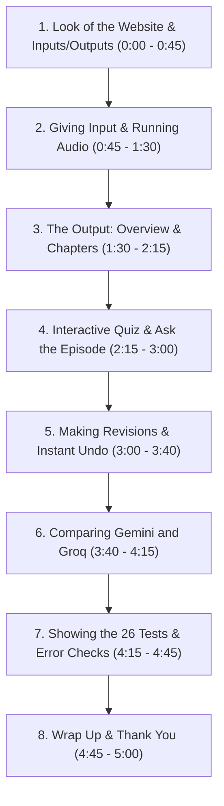

# Podcast Companion — Demo Video Script (Easy Words & Precise Actions)

> **Goal:** A clear, friendly 4 to 5-minute video walkthrough.  
> **Speaker:** Moazzem Hossain Majumder  
> **Language:** Simple, easy everyday English. No confusing jargon.  
> **Screen:** Live app running at **https://podcast-companion.onrender.com** in dark mode.

---

## 1. Quick Setup Before You Record

1. **Wake up the website:** Open [https://podcast-companion.onrender.com](https://podcast-companion.onrender.com) 2 minutes before recording so it responds instantly.
2. **Have 3 tabs open in your browser:**
   - **Tab 1:** The live website (`https://podcast-companion.onrender.com`)
   - **Tab 2:** Your GitHub `README.md` (scrolled to the 26 screenshot test pictures)
   - **Tab 3:** The `RESEARCH.pdf` file opened in the browser
3. **Keep it clean:** Close browser developer tools, set browser zoom to 100%, and mute your phone.

---

## 2. Word-for-Word Video Script (With Exact Mouse & Hover Moves)

---

### Step 1: Look of the Website, What Goes In, What Comes Out
- **Time:** `0:00 – 0:45` (45 seconds)
- **Mouse & Screen Actions:**
  - Keep the screen on the live website home page.
  - **[HOVER]** over the top title: **Podcast Companion**.
  - **[HOVER]** across the three input tabs one by one:
    1. Hover over **Paste text**.
    2. Hover over **Upload document**.
    3. Hover over **Audio file**.
  - **[HOVER]** over the **Model ⌄** dropdown button in the top right. Click it once to show *Auto*, *Google Gemini*, and *Groq*, then click it again to close it.
  - **[HOVER]** over the small grey text showing the limits: *Max 150,000 characters · Audio up to 60 MB / 90 min*.
- **What to SAY (Simple English):**
  > *"Hello everyone! My name is Moazzem Hossain Majumder, and this is **Podcast Companion**, running live on Render.*
  >
  > *Let me first explain how this website looks and works.*
  >
  > *As you can see, the design is clean, dark, and easy on the eyes. At the top, we have three different ways to provide input:*
  > * *First, you can **paste plain text** or text with timestamps.*
  > * *Second, you can **upload documents** like text files, markdown, or subtitle files.*
  > * *Third, you can **upload real audio files** like MP3, WAV, or M4A.*
  >
  > *And up here, you can pick which AI model to use: Auto, Google Gemini, or Groq.*
  >
  > *Now, what output will we get? In a few seconds, the app turns any podcast into five helpful things:*
  > * *A clear **summary and key takeaways**,*
  > * *A clickable **chapter timeline** with exact timestamps,*
  > * *A fun **interactive quiz** to test what you learned,*
  > * *An **'Ask the Episode'** question box,*
  > * *And easy **download buttons** to save everything as Markdown or JSON.*
  >
  > *Best of all, every single takeaway and quiz answer comes with a real quote from the episode, so you know you can trust it."*

---

### Step 2: Providing Audio Input & Watching It Run
- **Time:** `0:45 – 1:30` (45 seconds)
- **Mouse & Screen Actions:**
  - Click on the **Audio file** tab.
  - **[HOVER]** over the **Try a sample:** row. Move your mouse across the format buttons: `.mp3`, `.m4a`, `.mp4`, `.wav`, `.ogg`, `.flac`, `.webm`, `.aac`.
  - Click the **.mp3** button. Notice how the file name appears in the box.
  - **[HOVER]** over the small privacy note at the bottom (*Privacy: Content is processed by Google Gemini and Groq...*).
  - Click the purple **Generate Companion** button.
  - Watch the progress box update: *Validating file → Transcribing with Groq Whisper → Creating sections*.
- **What to SAY (Simple English):**
  > *"Now let's try it with real audio.*
  >
  > *Notice this helpful row here called 'Try a sample'. You don't even have to hunt for your own files—we built in real samples for all eight popular audio formats.*
  >
  > *I will click on **.mp3**. This loads an 11-minute educational podcast about Undersea Internet Cables.*
  >
  > *Down here, there is a clear privacy note letting users know how their data is handled.*
  >
  > *Now I click **Generate Companion**.*
  >
  > *Look at the progress bar: behind the scenes, the server checks the audio file header, uses Whisper to transcribe speech into text with exact time tags, and then sends the text to our AI pipeline. Everything updates live on screen."*

---

### Step 3: Looking at the Output (Overview & Chapters)
- **Time:** `1:30 – 2:15` (45 seconds)
- **Mouse & Screen Actions:**
  - The results page appears smoothly.
  - **[HOVER]** over the top info badge: `22 passages · from audio · with real timestamps · model: Auto`.
  - Scroll down through the **Episode Overview**:
    - Show the Title and the One-Sentence summary.
    - Show the 150-word summary paragraph.
    - **[HOVER]** over the **Takeaways** list. Hover directly over one of the citation chips (for example, `source passage 3`).
  - Switch to the **Chapters** tab (or look at the chapter strip at the top).
  - **[HOVER]** slowly across each colored block in the **Chapter Timeline Strip**:
    - Point out how each block has a different width depending on how long that topic lasted.
    - Show the tooltip that pops up with the chapter title.
  - **[CLICK]** on one of the Chapter cards below (e.g. *Chapter 3: Deep Sea Faults*).
  - Watch the page smoothly scroll down and highlight that exact sentence in the full transcript!
- **What to SAY (Simple English):**
  > *"And here are our results!*
  >
  > *At the very top, this badge tells us: 22 passages were found, with real timestamps from audio.*
  >
  > *In the Overview, we have a catchy title, a short one-liner, a 150-word summary, and key takeaways.*
  >
  > *Now, look closely as I hover over these small citation tags next to each takeaway. Every single point links directly to a passage in the transcript. The AI cannot make up facts because our code checks every citation.*
  >
  > *Next, look at this colorful chapter timeline bar at the top.*
  >
  > *As I hover my mouse over these blocks, you can see the name and start time of each chapter. Notice how the blocks are different widths: longer topics get wider blocks, perfectly matching the audio duration.*
  >
  > *These timestamps are 100% real from Whisper. When I click this chapter, watch—it jumps straight to that exact moment in the transcript and highlights it!"*

---

### Step 4: The Interactive Quiz & "Ask the Episode"
- **Time:** `2:15 – 3:00` (45 seconds)
- **Mouse & Screen Actions:**
  - Click on the **Quiz** tab.
  - **[HOVER]** over the four answer choices for Question 1.
  - **[CLICK]** on the **correct** answer.
    - Show the option turn **bright green**.
    - Show the score counter update at the top: `Score: 1/3`.
    - **[HOVER]** over the green explanation box.
    - **[HOVER]** over the **Source quote** box beneath it.
    - **[CLICK]** on the blue quote link — watch the transcript scroll and highlight the source sentence!
  - Scroll down to Question 2.
  - **[CLICK]** on an **incorrect** answer.
    - Show the clicked option turn **red**.
    - Show the correct answer highlight in green with the explanation.
  - Click on the **Ask the episode** tab.
  - Type: *"What causes most undersea cable damage?"* → Click **Ask**.
    - Show the answer with a verified quote mentioning fishing nets and boat anchors.
  - Type: *"Who won the 2022 World Cup?"* → Click **Ask**.
    - Show the polite refusal: *"I won't answer because this is not mentioned in the episode."*
- **What to SAY (Simple English):**
  > *"Now let's check out the Interactive Quiz.*
  >
  > *Here are multiple-choice questions to test your understanding. As I hover over the choices, they highlight nicely.*
  >
  > *Let's click the right answer on Question 1. It turns green right away, gives us an explanation, and updates our score.*
  >
  > *Even better: look at this box called 'Source quote'. The AI had to provide the exact sentence from the episode. When I click this quote link, the app scrolls right to where the speaker said it in the transcript!*
  >
  > *If I click a wrong answer on Question 2, it turns red and gently explains the correct answer.*
  >
  > *We also have 'Ask the Episode'. If I ask something from the episode—like 'What causes cable damage?'—it gives an accurate answer with a quote.*
  >
  > *But if I ask an off-topic question—like 'Who won the 2022 World Cup?'—it honestly says it won't answer because the episode doesn't cover it. It never guesses or hallucinates."*

---

### Step 5: Changing a Section (Revisions) & Instant Undo
- **Time:** `3:00 – 3:40` (40 seconds)
- **Mouse & Screen Actions:**
  - Click back to the **Overview** tab.
  - Scroll down to the bottom of the overview to the **Revise this section** card.
  - **[HOVER]** over the quick preset chips:
    - Hover over **Shorter**.
    - Hover over **Simpler language**.
    - Hover over **More detail**.
  - **[CLICK]** on the **Shorter** preset chip.
  - Click the **Revise overview** button.
  - Show the spinner appear **only** inside the overview card.
  - The new shorter overview appears with a yellow badge: `Revised: "Make the summary much shorter...". Only this section was regenerated.`
  - Click on the **Quiz** tab and **Chapters** tab for a second to show they are **completely untouched**.
  - Click back to Overview.
  - **[HOVER]** over the **Undo last change** button.
  - **[CLICK]** on **Undo last change**.
  - Watch the original full-length overview instantly come back with a friendly notification: *Reverted to the previous version*!
- **What to SAY (Simple English):**
  > *"Another big requirement of this challenge is making meaningful revisions.*
  >
  > *Normally, AI tools force you to start over and re-generate everything. But in Podcast Companion, you can change just one section at a time.*
  >
  > *Down here, we have quick preset buttons: 'Shorter', 'Simpler language', or 'More detail'.*
  >
  > *Watch: I will click 'Shorter' and hit Revise. Only the Overview section is updated. The chapters and the quiz are completely untouched, which saves time and tokens.*
  >
  > *And if you change your mind? Just click this 'Undo' button. Instantly, our previous summary is restored without making another slow web call."*

---

### Step 6: Comparing Gemini vs. Groq Side-by-Side
- **Time:** `3:40 – 4:15` (35 seconds)
- **Mouse & Screen Actions:**
  - Click the **Compare models** tab in the main navigation.
  - **[HOVER]** across the side-by-side comparison table:
    - Point to column 1: **Google Gemini** (`gemini-3.1-flash-lite`).
    - Point to column 2: **Groq** (`openai/gpt-oss-120b`).
  - **[HOVER]** over the latency rows:
    - Hover over Overview Time: `5.2 s` vs `1.5 s`.
    - Hover over Chapters Time: `1.5 s` vs `1.8 s`.
    - Hover over Quiz Time: `5.8 s` vs `3.5 s`.
  - **[HOVER]** over the **Verified quiz questions**: `3 / 3` for both models.
  - **[HOVER]** over the download buttons: **Export comparison (.md)** and **Export comparison (.json)**.
- **What to SAY (Simple English):**
  > *"The challenge also asked us to compare at least two technical options.*
  >
  > *Instead of just writing about it in a paper, we built a live model comparison tab directly into the website.*
  >
  > *Here, Google Gemini and Groq ran on the exact same podcast transcript with pinned models, meaning there is no hidden switching.*
  >
  > *Look at the numbers: Groq is extremely fast, answering in just 1.5 seconds. Meanwhile, Google Gemini is great because it has a huge memory window that can fit multi-hour podcasts.*
  >
  > *Most importantly, both models scored 100% on our quote verification check, showing that our verification system works reliably with any good AI model."*

---

### Step 7: Showing the 26 Tests & Safety Guardrails
- **Time:** `4:15 – 4:45` (30 seconds)
- **Mouse & Screen Actions:**
  - Smoothly switch to **Tab 2** (GitHub `README.md` open at `## Test Execution Log & Visual Verification`).
  - Scroll through the 26 screenshot pictures slowly:
    - Show Group 1 (Plain text & timestamped samples).
    - Show Group 2 (Text documents: Plato, Changelog podcast, NASA subtitle files).
    - Show Group 3 (All 8 audio file formats: MP3, WAV, MP4, FLAC, M4A, OGG, WebM, AAC).
    - Show Group 7 (Error screenshots).
  - Switch back to **Tab 1** (Live app) to show a live error guardrail:
    - Click **Paste text**.
    - Type just two words: *"Hello test"* (under 200 characters).
    - Click **Build my companion**.
    - Point to the red error banner: *The transcript is too short (10 characters). Provide at least 200 characters.*
- **What to SAY (Simple English):**
  > *"To be 100% sure this app is stable and battle-tested, we ran and took screenshots of **26 separate tests** across all features and file formats.*
  >
  > *Here in our README, you can see dark-mode screenshots for every test: from reading Plato's writings and NASA astronaut subtitles, to converting video files into audio, all the way to testing eight different audio formats.*
  >
  > *We also added smart safety guardrails. Watch this: if someone enters a tiny two-word snippet, the app immediately catches it with a clear, friendly error before wasting any AI budget.*
  >
  > *And if someone tries to upload a fake file—like a text file renamed to .mp3—our server checks the file header and safely rejects it."*

---

### Step 8: Research PDF & Wrap Up
- **Time:** `4:45 – 5:00` (15 seconds)
- **Mouse & Screen Actions:**
  - Switch to **Tab 3** (`RESEARCH.pdf`).
  - Scroll past the clean title and the easy comparison tables.
  - Switch back to Tab 1 (the live app results page).
  - Rest mouse on the clean header.
- **What to SAY (Simple English):**
  > *"Finally, we compiled our research into a short, easy-to-read PDF, and our complete code with 135 passing tests is available on GitHub.*
  >
  > *Thank you so much for watching, and I hope you enjoy using Podcast Companion!"*

---

## 3. Presenter's Cheat Sheet (Keep this open next to you)

| Time | Where to Look | What to Click | What to Say in 1 Sentence |
|---|---|---|---|
| `0:00` | Tab 1 (App home) | Hover over tabs & Model menu | "Here is the website: clean dark design, accepts text, docs, or audio, and gives structured, verified summaries." |
| `0:45` | Audio tab | Click `.mp3` sample → Generate | "We support 8 audio formats; let's run our 11-minute sample episode." |
| `1:30` | Overview & Chapters | Hover over citation chips & chapter bar; click a chapter | "Notice citations on every takeaway; timeline blocks match time length, and clicking jumps right into the transcript." |
| `2:15` | Quiz & Ask tab | Click 1 right, 1 wrong, click quote link; Ask 2 questions | "Quiz gives instant feedback and verified quotes; off-topic questions are politely refused." |
| `3:00` | Overview revisions | Click 'Shorter' preset → Revise → Click 'Undo' | "You can revise just one section without redoing the rest, and Undo works instantly." |
| `3:40` | Compare models tab | Hover over latency & questions row | "Groq is lightning fast; Gemini handles long episodes; both passed 100% of quote tests." |
| `4:15` | Tab 2 (README tests) | Scroll screenshots → Tab 1: type 2 words to show error | "We proved all 26 test cases with screenshots, and added safety guardrails for short or bad files." |
| `4:45` | Tab 3 (Research PDF) | Scroll PDF → Tab 1 wrap up | "All research notes, code, and 135 passing tests are on GitHub. Thank you!" |
