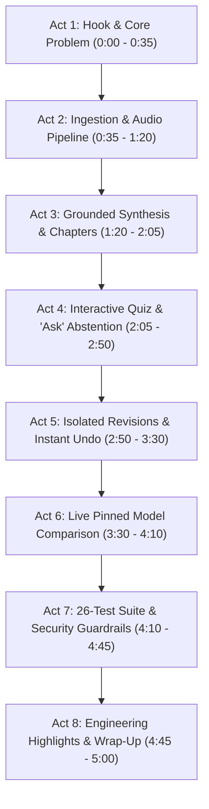

# Podcast Companion — Demo Video Master Guide & Director's Script

> **Target Duration:** 4.5 – 5.0 Minutes  
> **Format:** Full-screen 1080p screen recording (Loom, OBS, or QuickTime) + Voiceover Microphone  
> **Presenter:** Moazzem Hossain Majumder  
> **Objective:** Demonstrate the live deployed application, explain core technical decisions, showcase the citation-grounding architecture, perform meaningful revisions, benchmark Gemini vs. Groq, and present the 26-test visual verification suite.

---

## 1. Pre-Recording Staging & Preparation

Before hitting "Record", prepare your workspace so the demonstration is 100% fluid with zero waiting or awkward window switching:

### A. Wake up the Live Service
- Render free-tier instances sleep after 15 minutes of inactivity.
- Open **[https://podcast-companion.onrender.com](https://podcast-companion.onrender.com)** 2 minutes before recording. Run a quick sample run to ensure the container is warm and responsive.

### B. Setup Three Browser Tabs in One Window
- **Tab 1 (Active App):** `https://podcast-companion.onrender.com` (Dark Mode, Zoom: 100%)
- **Tab 2 (Test Suite in README):** GitHub repository `README.md` scrolled directly to `## Test Execution Log & Visual Verification` (showing the 26 dark-mode screenshots).
- **Tab 3 (Research Paper):** `RESEARCH.pdf` opened in your browser viewer (showing executive summary and comparison matrix).

### C. Audio & Screen Configuration
- Resolution: 1920x1080 (1080p).
- Browser address bar visible (proves live Render URL).
- Browser DevTools / console kept **closed** for a clean user view.
- Clear desktop notifications and mute system sounds.

---

## 2. Master Storyboard & Timed Script

Below is the complete, word-for-word spoken transcript paired with exact screen interactions and technical discussion points.

---

### Act 1: The Hook & The Core Problem
- **Time:** `0:00 – 0:35` (35 seconds)
- **Screen Action:** 
  - Start on Tab 1 (`https://podcast-companion.onrender.com`).
  - Move mouse smoothly over the clean dark-mode interface.
  - Hover briefly over the three input tabs: **Paste text**, **Upload document**, **Audio file**.
  - Click the **Model ⌄** menu to show available models: *Auto*, *Google Gemini*, *Groq*.
- **What to SAY (Voiceover):**
  > *"Hello everyone! My name is Moazzem Hossain Majumder, and this is **Podcast Companion**, deployed live on Render for the Thealon AI Engineering Challenge.*
  >
  > *Every day, millions of people listen to educational podcasts, but retaining and finding specific information is painful. Typical AI tools generate generic, hallucinated summaries that you can’t verify.*
  >
  > *Podcast Companion solves this through **deterministic grounding**: transforming raw podcast audio or transcripts into an interactive companion where every takeaway, chapter, quiz answer, and conversational query is strictly verified against verbatim source citations."*
- **What to DISCUSS (Engineering Context):**
  - Point out that limits are not hardcoded in the frontend; they are dynamically fetched from the `/api/config` backend endpoint to ensure strict client-server alignment.

---

### Act 2: Multimodal Ingestion & Audio Pipeline
- **Time:** `0:35 – 1:20` (45 seconds)
- **Screen Action:**
  - Click the **Audio file** tab.
  - Point to the **Try a sample** row displaying 8 formats (`.mp3`, `.m4a`, `.mp4`, `.wav`, `.ogg`, `.flac`, `.webm`, `.aac`).
  - Click the **.mp3** button (loads the built-in 11-minute episode on Undersea Internet Cables).
  - Click **Generate Companion**.
  - Show the live progress indicator transitioning through stages: *Validating file → Transcoding / Probing → Whisper ASR Transcription → Generating companion sections*.
- **What to SAY (Voiceover):**
  > *"Let's look at content ingestion. The application accepts raw text, subtitle files like SRT and VTT, and all major audio formats up to 60 MB and 90 minutes.*
  >
  > *I'll click our built-in 11-minute MP3 sample. Behind the scenes, the server inspects the audio's magic bytes to prevent spoofing, probes duration using a bundled static ffmpeg binary, and automatically downsamples to 16 kHz mono.*
  >
  > *If an audio file exceeds 24 megabytes, our background pipeline splits it into 20-minute chunks, transcribes each via Groq Whisper with verbose JSON segment offsets, and stitches the transcript with verified millisecond time offsets."*
- **What to DISCUSS (Engineering Context):**
  - Highlight why Render was chosen over Vercel: Vercel has a hard 4.5 MB request ceiling that breaks podcast audio uploads.

---

### Act 3: Grounded Synthesis & Navigable Chapters
- **Time:** `1:20 – 2:05` (45 seconds)
- **Screen Action:**
  - The results view loads.
  - Highlight the metadata banner: `22 passages · from audio · with real timestamps · model: Auto`.
  - Scroll through the **Episode Overview**: title, one-liner, summary, themes, takeaways.
  - Hover over a takeaway chip (e.g., `source passage 3`) and show the citation tag.
  - Switch to the **Chapters** tab or view the proportional chapter timeline strip.
  - Hover over the timeline blocks to show chapter titles and start times.
  - Click a chapter card (e.g., *Chapter 3: Deep Sea Faults & Cable Ships*) — demonstrate how the page jumps directly to that passage in the full transcript view.
- **What to SAY (Voiceover):**
  > *"The results are in! Look at the top metadata badge: it explicitly informs the user that 22 passages were parsed with real timestamps.*
  >
  > *In the Overview, we get a concise 150-word summary, key themes, and actionable takeaways. Notice these citation chips: every takeaway links to a specific numbered passage. If the LLM generates a takeaway without a real citation, our deterministic Python validator strips it out.*
  >
  > *Now look at the chapter strip: the block widths are strictly proportional to the actual duration of each topic. More importantly, these timestamps are real—extracted directly from Whisper audio segments, never hallucinated by the model. When I click a chapter, it jumps right to that exact time in the transcript."*
- **What to DISCUSS (Engineering Context):**
  - Mention the **Honest Timestamp Policy**: If plain text without times is uploaded, the app displays passage numbers and an explicit badge explaining why timestamps are absent, rather than guessing.

---

### Act 4: Interactive Learning Quiz & "Ask the Episode"
- **Time:** `2:05 – 2:50` (45 seconds)
- **Screen Action:**
  - Click the **Quiz** tab.
  - Read Question 1. Click the **correct** answer: observe the green badge, immediate score increment (`Score: 1/3`), and explanation.
  - Point to the **Source quote** box beneath the explanation. Click the quote link — show how the transcript smoothly scrolls and highlights the passage.
  - Read Question 2. Click an **incorrect** answer: observe the red badge, the highlighted correct answer, and the explanation.
  - Switch to the **Ask the episode** tab.
  - Type a covered question: *"What causes most undersea cable damage?"* → Click Ask → Show answer citing fishing nets and anchors with a verified quote.
  - Type an uncovered question: *"Who won the 2022 World Cup?"* → Click Ask → Show the system's honest refusal: *"I won't answer because this is not mentioned in the episode."*
- **What to SAY (Voiceover):**
  > *"Next is our interactive learning quiz. When I click an option, feedback is instantaneous. But what makes this truly trustworthy is the verbatim quote requirement.*
  >
  > *Every question generated by the LLM must provide an exact source quote. The backend verifies that this quote exists in the source transcript before showing the question. If I click this quote, the app jumps immediately to the exact passage.*
  >
  > *We also have 'Ask the Episode'. When I ask about cable damage, it answers with a verified quote. But when I ask an out-of-domain question—like 'Who won the 2022 World Cup?'—the model strictly abstains rather than making up answers."*
- **What to DISCUSS (Engineering Context):**
  - Mention server-side option shuffling: models often exhibit a bias toward placing the correct answer in position B; our pipeline shuffles answer positions on the server.

---

### Act 5: Isolated Section Revisions & Non-Destructive Undo
- **Time:** `2:50 – 3:30` (40 seconds)
- **Screen Action:**
  - Switch back to the **Overview** tab.
  - Point to the revision controls at the bottom of the section.
  - Click the preset chip: **"Shorter"** (or type *"Make it 60 words"*).
  - Click **Revise overview**.
  - Show that a spinner appears **only** on the Overview section. Show that the Chapters and Quiz tabs are completely unaffected.
  - Notice the revision banner: `Revised: "Make the summary much shorter...". Only this section was regenerated.`
  - Immediately click **Undo last change** button.
  - Show the original full-length overview instantly restored with a toast notification: *"Reverted to the previous version"*.
- **What to SAY (Voiceover):**
  > *"A critical requirement of the challenge is meaningful revision. Many AI tools force a full, expensive regeneration of the entire page.*
  >
  > *Here, revisions are strictly isolated. Watch as I click the preset chip 'Shorter'. Only the Overview is sent to the `/api/generate` endpoint. The chapters, quiz, and transcript remain completely untouched, saving API quota and preserving user state.*
  >
  > *The revision banner clearly indicates what changed. And if the user prefers the earlier version, our client-side state stack provides instant, non-destructive Undo with zero extra network latency."*
- **What to DISCUSS (Engineering Context):**
  - Revisions support both quick presets and custom free-text prompts, guarded by the exact same Pydantic schema and citation validators.

---

### Act 6: Live Empirical Model Comparison (Gemini vs. Groq)
- **Time:** `3:30 – 4:10` (40 seconds)
- **Screen Action:**
  - Click the **Compare models** tab in the main navigation.
  - Point to the side-by-side benchmark table comparing **Google Gemini** (`gemini-3.1-flash-lite`) and **Groq** (`openai/gpt-oss-120b`).
  - Highlight the real metrics:
    - Overview Latency: `5.2 s` (Gemini) vs. `1.5 s` (Groq).
    - Chapters Latency: `1.5 s` vs. `1.8 s`.
    - Quiz Latency: `5.8 s` vs. `3.5 s`.
    - Validation re-asks: `0` for both.
    - Verified questions: `3 / 3` for both.
  - Click the **Export comparison (.md)** button to show instant exportability.
- **What to SAY (Voiceover):**
  > *"The challenge also calls for a deep technical comparison of at least two options. Rather than just writing about it, we built a live side-by-side comparison engine directly into the product.*
  >
  > *In the Compare Models tab, we run Google Gemini Flash-Lite against Groq's GPT-OSS-120B on the exact same transcript. Crucially, each provider is pinned with zero cross-fallback, guaranteeing an uncontaminated benchmark.*
  >
  > *As you can see, Groq delivers sub-2-second inference speed, while Gemini provides superior context capacity for long multi-hour episodes. Both models passed 100% of our deterministic quote verifications with zero re-asks."*
- **What to DISCUSS (Engineering Context):**
  - Discuss the real-world discovery: Groq retired `llama-3.3-70b-versatile` on August 16, 2026; live benchmarking caught this and prompted the migration to `openai/gpt-oss-120b`.

---

### Act 7: The 26-Test Suite Showcase & Security Guardrails
- **Time:** `4:10 – 4:45` (35 seconds)
- **Screen Action:**
  - Switch smoothly to **Tab 2** (GitHub `README.md` at `## Test Execution Log & Visual Verification`).
  - Scroll through the 7 test categories, showcasing the full-width high-resolution dark mode screenshots:
    - *Group 1:* Built-in samples (plain text vs. timestamped).
    - *Group 2:* File formats (Plato's `.txt`, Changelog `.md`, NASA `.srt`, LibriVox `.vtt`).
    - *Group 3:* Real audio containers (MP3, WAV, MP4 video demux, FLAC, M4A, OGG, WebM, AAC).
    - *Group 4 & 5:* Interactive quiz & revisions.
    - *Group 6 & 7:* Model comparison and error guardrails.
  - Switch back to **Tab 1** (Live app) and quickly demonstrate a live guardrail:
    - Paste a short 3-word string: *"Hello podcast test"* → Click Generate → Show the red HTTP 422 alert: *"The transcript is too short (19 characters). Provide at least 200 characters."*
    - (Optional) Attempt to upload a text file renamed to `.mp3` → Show magic-byte HTTP 415 rejection.
- **What to SAY (Voiceover):**
  > *"To ensure true production resilience, we designed and visually verified 26 distinct test cases across 7 categories in our README.*
  >
  > *We tested every audio format, subtitle cues, and technical markdown documents like Plato and the Changelog podcast. We also engineered strict OWASP security guardrails.*
  >
  > *Watch this: if a user submits a tiny transcript under 200 characters, it fails fast with an informative HTTP 422 error before consuming any model tokens. And if someone renames a text file to .mp3, our backend magic-byte sniffer rejects it with HTTP 415 before ffmpeg or Whisper even touch it."*
- **What to DISCUSS (Engineering Context):**
  - Explain how the test suite includes 135 automated unit/integration tests running via `pytest` plus end-to-end browser tests in `jsdom`.

---

### Act 8: Research PDF, Codebase Architecture & Wrap-Up
- **Time:** `4:45 – 5:00` (15 seconds)
- **Screen Action:**
  - Switch to **Tab 3** (`RESEARCH.pdf` opened in browser).
  - Scroll through the title page, the technology comparison table, and the OWASP security matrix.
  - Switch back to Tab 1 / README top.
  - Cursor resting on the clean app header.
- **What to SAY (Voiceover):**
  > *"Finally, our complete technical documentation—including our standalone Research Paper PDF, engineering notes on our 3 debugging case studies, and three prioritized next steps—is fully open-source in the GitHub repository.*
  >
  > *Thank you very much for your time, and I look forward to your feedback!"*

---

## 3. Quick Reference Card for the Presenter

Keep this small table beside you while recording:

| Time | What to Click | What to Emphasize |
|---|---|---|
| `0:00` | Start on live Render app, click Model dropdown | Stateless, citation-grounded, dynamic API limits |
| `0:35` | Audio tab → `.mp3` sample → Generate | Magic-byte sniffing, static ffmpeg, Whisper chunks |
| `1:20` | Hover overview chips, click chapter card | Grounded citations, proportional strip, honest timestamps |
| `2:05` | Quiz tab: 1 correct, 1 wrong, click quote; Ask tab | Instant scoring, quote verification, strict abstention |
| `2:50` | Overview → Click 'Shorter' preset → Click 'Undo' | Isolated section regeneration, no waste, instant rollback |
| `3:30` | Compare models tab | Side-by-side Gemini vs Groq, pinned models, no fallback |
| `4:10` | Switch to README (26 tests) → Show short text error | 26 verified tests, 7 categories, HTTP 422 & 415 guardrails |
| `4:45` | Switch to RESEARCH.pdf tab → Wrap up | Full compliance, 135 passing tests, thank reviewer |

---

## 4. Post-Recording Quality Checklist

Before uploading the video to Loom, YouTube, or Google Drive:
- [ ] **Visual Clarity:** Can you clearly read the text in dark mode at 1080p?
- [ ] **Pacing:** Did the recording stay within 4.5 to 5 minutes?
- [ ] **Sound:** Is the voiceover loud, clear, and free of background hiss?
- [ ] **Key Requirements Shown:**
  - [x] Multimodal audio/text ingestion.
  - [x] Overview with passage citations.
  - [x] Proportional chapters jumping to transcript.
  - [x] Interactive quiz scoring with verbatim quote jump.
  - [x] Isolated section revision + non-destructive undo.
  - [x] Gemini vs. Groq comparison table.
  - [x] 26-test verification log with dark-mode screenshots.
  - [x] Error guardrails (HTTP 422 / 415).
  - [x] Standalone Research PDF shown.
