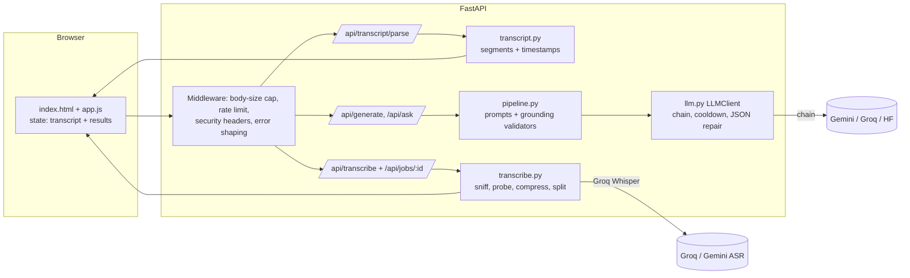

# Engineering notes

## A. Tool and approach comparison
See [RESEARCH.md](RESEARCH.md) (LLMs, speech-to-text, hosting, reliability approaches, with sources). Final stack: **Gemini Flash (primary) → Gemini Flash-Lite → Groq gpt-oss-120b → Hugging Face** for text; **Groq Whisper turbo → Whisper large-v3 → Gemini (text-only)** for audio; **FastAPI + vanilla JS** on **Render free**. Python/FastAPI was chosen for clarity and because the fallback/validation logic is the interesting part; a no-build front end keeps the code reviewable.

**Comparing the two providers in the product itself.** Every `/api/generate` and `/api/ask` request takes `provider: "auto" | "gemini" | "groq"`. `auto` walks the whole fallback chain; a named provider restricts `LLMClient.complete_json` to that provider's chain entries (it may still use its *own* backup model, e.g. Flash → Flash-Lite, which the UI labels as "backup model used"), so a Gemini-vs-Groq comparison is never silently contaminated by the other provider. Responses carry `latency_ms` and `attempts`, which feed the **Compare models** tab. A pinned failure reports *which* provider failed: not configured (503), rate-limited (503 + Retry-After), or transcript too long for Groq's free tier (413 `too_long_for_provider`). `/api/transcribe` accepts `asr_provider` the same way (Groq Whisper with timestamps vs Gemini text-only).

## B. System architecture

**Processing stages**

1. **Ingest.** Text/SRT/VTT → `transcript.py` cleans, detects subtitle or inline timestamps (only if they are clearly structural: ≥50% of lines, monotonic), groups tiny cues into ~600-char segments, and numbers them. Audio → magic-byte sniff → streamed to a temp dir → duration probe (reject over-long files *before* spending quota) → if >24 MB, compress to 16 kHz mono MP3 and split into 20-minute chunks → Whisper per chunk with measured time offsets → merge. The browser polls a job endpoint (so no HTTP request is held open for minutes, which also dodges proxy timeouts).
2. **Generate.** The browser sends the transcript to `/api/generate` once per section (overview, chapters, quiz) in parallel. The server is **stateless**: it re-validates the transcript each time and renders it as `[S12 | 3:41] text` lines.
3. **Validate.** The model's JSON goes through Pydantic (shape) then section-specific grounding checks (truth): segment IDs exist, chapters strictly increase, timestamps looked up from segments, quiz quotes verified, options shuffled.
4. **Recover.** Malformed or ungrounded output → one repair attempt that includes the validator's exact complaint → next chain entry. Rate limits → cooldown + next entry. Auth/404 → entry disabled.
5. **Revise.** Same endpoint with `instruction` + `previous`. Only that section is regenerated; validators and fallback apply identically. The client keeps a history stack for undo.
6. **Present.** Rendering via `textContent` only; cite chips jump to highlighted transcript passages; exports built client-side.

**Why the server is stateless:** transcripts live in the browser, so there is nothing to leak, no database to run, and free-tier restarts lose nothing except in-flight audio jobs.

## C. Debugging example

I'm reporting what actually happened while building this, including that one important issue was found by review, not by an observed failure.

### The bug no test could see: CSP silently disabling inline styles
- **What went wrong.** I wrote a strict Content-Security-Policy (`style-src 'self' https://fonts.googleapis.com`, no `'unsafe-inline'`) and, separately, a DOM helper `h()` that applied a `style` option with `setAttribute('style', …)`. Browsers block inline `style` *attributes* under that policy, so the chapter strip (whose block widths are set inline to be proportional to chapter length) would render as equal-width blocks, and several margins would vanish, **with no error in the page, only a console CSP report**.
- **Why tests didn't catch it.** The jsdom UI test (14 steps at the time) passed completely: jsdom doesn't enforce CSP, and the unit tests don't render.
- **How I found it.** While reviewing the security headers against the front-end code, I cross-checked each CSP directive against how the JS touches the DOM. `style-src` plus a `setAttribute('style')` call site was the mismatch.
- **What I changed.** `h()` now assigns `el.style.cssText`, which goes through the CSSOM and is allowed by the policy. I added a regression step to the UI test that spies on `Element.prototype.setAttribute` and fails if the app ever sets a `style` attribute.
- **Outcome.** Fixed at the code level and guarded by a test. At first I could not open a real browser in my build environment, so the fix was unconfirmed. I later confirmed it in headless Chromium (Playwright): the chapter blocks render with proportional, visibly different widths.
- **What I learned.** Security headers and UI code are coupled; a test harness that doesn't enforce the policy gives false confidence. Test the *contract* you can't enforce (here: "never call `setAttribute('style')`").

### A bug I watched happen: the model menu that closed the instant it opened
- **What went wrong.** I replaced the provider radio cards with a compact dropdown (like Claude's model picker). In a real browser, clicking **Model ⌄** did nothing visible. The automated jsdom UI test passed.
- **How I investigated.** A Playwright screenshot showed the button in its hover state but no menu. Reading the DOM straight after the click showed `menu.hidden === true` and the `open` class already removed, so the menu *had* opened and been closed in the same click. The only code that closes it on a click is the "click outside closes the menu" listener on `document`. That pointed to the hypothesis that the click was being seen as *outside*.
- **Root cause.** `open()` re-rendered the trigger button's contents. The user's click landed on the inner ``, which `open()` had just replaced. By the time the event reached the `document` listener, `event.target` was a detached node, so `root.contains(event.target)` returned `false`, and the menu closed itself.
- **What I changed.** The listener now uses `event.composedPath().includes(root)`, which still holds the original path even if nodes were removed. `open()` re-renders only the menu, not the button. The UI test now clicks the text **inside** the button, as a person does. Before, it dispatched the click on the button element, which is why it never reproduced the bug.
- **Outcome / lesson.** Fixed and regression-tested. A test that clicks a synthetic target can pass while every real user fails, so tests should click where a human clicks. Also, re-rendering an element during its own click handler invalidates `event.target`.

### Problems found by running against the real providers
- **"Groq not configured" with a valid Groq key.** On the first live run, the Groq option was greyed out even though Groq transcription worked. `/api/health` showed `llm_options.groq.models == []`. The `.env` had a custom `LLM_CHAIN` listing only Gemini models, and the client only builds entries from that list. Fix: `build_llm` appends a default model for any provider that has a key but no chain entry (`test_provider_with_key_but_missing_from_llm_chain_is_still_selectable`).
- **Primary Gemini model silently skipped.** The live Gemini-vs-Groq benchmark showed most Gemini answers coming from the backup `gemini-3.1-flash-lite`, with 20-35 s latencies that included the failed first attempt. The API reported *that* a fallback happened, but not *why*. Responses now carry `meta.skipped` (for example, `gemini:gemini-3.5-flash (rate limited)`), and the UI and Compare tab show it.
- **Groq's model had been shut down.** In the Gemini-vs-Groq benchmark every Groq call failed in about 0.2 s with a generic "busy" message. After errors started naming their cause, the response read `groq:llama-3.3-70b-versatile: model_unavailable`. Groq's deprecations page lists that model as shut down on 2026-08-16, although its models page still showed it as production. The default became the named replacement, `openai/gpt-oss-120b`. That is a reasoning model, so it gets 2× output headroom and `reasoning_effort: "low"`.
- **Groq's 8K tokens-per-minute budget.** With the new model, the first section succeeded in about 2 s and the next one in the same minute got a 429 (each section of the 11-minute sample is roughly 4.5-5K tokens). The client now waits out short cooldowns (at most 30 s per wait, 60 s in total) instead of failing. Re-measured: all three sections succeeded in parallel, with the quiz noting "Waited 12s…" (`test_two_short_waits_then_success_but_total_wait_is_capped`). Full numbers are in [RESEARCH.md §6](RESEARCH.md).
- **Stale responses after "New episode".** The UI test found that pressing *New episode* while sections were still generating crashed the page when the late responses arrived (`state.transcript` was `null`). Every async handler now checks that the episode it started with is still the open one, and drops the result otherwise.

### Two more problems found the same way (design review against provider docs)
- **Model retirement.** While building, Gemini's docs listed `gemini-2.5-flash` (the model most tutorials use) for shutdown on 2026-10-16, and forum users reported 404s from it months early. I turned the model into a configurable chain with a permanent-disable on 404/auth errors (`test_auth_and_missing_model_disable_entry_permanently`). By the page's 2026-10-09 update, Google had reversed course and lists 2.5 Flash as "not deprecated". The date moved in *both* directions, which is the real lesson: never hard-code a model, and verify with `scripts/check_providers.py` rather than trusting a date.
- **Thinking tokens.** Gemini "thinking" models count hidden reasoning tokens toward `maxOutputTokens`, which can truncate the visible JSON (`finishReason: MAX_TOKENS`). I raised the limit to `4×requested + 4096` (cap 32768) and treat `MAX_TOKENS` as a retryable malformed output. (Reasoned from the documented behaviour; I could not observe it without live keys.)

### Failure scenarios deliberately tested (all automated)
| Scenario | Result |
|---|---|
| Primary model rate-limited (429 with `retryDelay`) | Entry put on cooldown, next provider used; subsequent calls skip it without waiting (`test_rate_limited_entry_is_skipped_during_cooldown`) |
| Truncated / fenced / trailing-comma JSON | Tolerated or repaired; truncation triggers a re-ask |
| Model invents a quiz quote | Question dropped; all invented → re-ask with the failures listed → fallback provider |
| Model cites segment 9999 / invents timestamps | IDs filtered; timestamps are never read from model output |
| Whisper turbo 429 | Falls to large-v3 |
| Groq down entirely | Gemini text-only fallback; timestamps dropped *for the whole transcript* and the UI explains why |
| Corrupt file with valid magic bytes | Clean `bad_audio` error, no crash/hang |
| Text file renamed `.mp3`; HLS playlist as audio | 415 before any processing |
| Oversized upload with and without `Content-Length` (chunked) | 413 mid-stream |
| Recording longer than limit | Rejected after a cheap probe, before any API call |
| Whisper hallucination on silence ("Thanks for watching") | Filtered via `no_speech_prob` + `avg_logprob` |
| Hostile model output (`` as a title) | Rendered inert; no script runs |
| Unexpected exception | 500 with a generic message; internals not leaked |

## D. Reliability and limitations

**Handling bad outputs.** Layered: shape validation → grounding validation → repair prompt → next provider → clear error with retry. Partial results are preferred to none (e.g. 5 of 6 questions verified is shown with a note), but below a minimum the section fails visibly instead of showing unverified content. Sections fail independently: a failed quiz never hides the overview.

**Failed requests / timeouts.** Per-call timeout (60 s), one transient retry, `Retry-After` honoured, HTTP 503 with a human wait time when everything is rate-limited. The browser has its own timeouts and a retry button. Audio jobs have a 40-minute ceiling and ffmpeg a 25-minute one.

**Unexpected input.** Binary-looking text, too short/long, control characters, giant single lines, no-punctuation blobs, non-monotonic "timestamps", wrong file types, absurd instruction lengths: all handled with specific messages.

**Known limitations** (also in the README): free hosting sleeps; tiny CPU makes compression slow; in-memory jobs/limits; quote verification ≠ correctness; summary sentences are cited but not individually fact-checked; fallback models only for short transcripts; segment-level timestamps; third-party processing of user content.

**Assumptions.** One instance; English-centric prompts (the model is told to answer in the transcript's language, which I could only test structurally, with Bengali text in the normaliser tests, not with live models); reviewers use the sample or their own non-confidential content.

## E. Cost and maintenance

**Today: $0.** Gemini/Groq/HF free tiers, Render free instance, no database.

**If it were paid (rough, assumptions stated):** a 1-hour English episode ≈ 9,000 words ≈ 12k tokens. Three generation calls ≈ 40k input + ~6k output tokens, i.e. about **1 US cent** at Flash-class pricing (third-party summaries cite ~$0.15 / $0.60 per million input/output tokens; check Google's pricing page). Groq's docs list Whisper-turbo at $0.04 per hour of audio. A Render Starter instance (no sleep) is about $7/month. Cost scales with episodes, not users, because nothing is stored.

**Dependencies:** 7 Python packages (pinned), Google Fonts (with system fallbacks), three AI vendors (any one suffices for text), ffmpeg via the `imageio-ffmpeg` wheel.

**Maintenance.** Expect **model-ID churn** (change `LLM_CHAIN`, no deploy of code); run `scripts/check_providers.py` monthly or when the app reports a backup model in use; run `scripts/smoke_live.py` after each deploy; CI runs the full suite. Keys rotate in the host dashboard only.

## F. Security summary
Keys only from the environment (header-based to Gemini, never logged); strict CSP and headers; per-IP and global concurrency limits; streaming size caps; magic-byte validation and forced-demuxer ffmpeg; temp files deleted per job; opaque job IDs; no server-side storage of user content; no stack traces or provider bodies in responses. See [RESEARCH.md §5](RESEARCH.md).

## G. Next steps (three, in priority order)

1. **Evaluation harness for faithfulness (reliability, highest priority).** Today I verify that quotes exist, and the Compare tab measures speed and verification pass rate per model, but I don't *measure* correctness. Build a small golden set (5-10 transcripts with hand-checked chapters/answers) and track quote-verification pass rate, chapter-boundary agreement and answer correctness per model, plus a sentence-level entailment check (summary sentence ↔ cited segments). *Why first:* model IDs change monthly, and this turns "it seems fine" into a regression gate. *Impact:* catches silent quality drops when a fallback model takes over; makes model swaps safe.
2. **Persistence and a real job queue (scalability/UX).** Store episodes under opaque IDs (SQLite → Postgres) and run audio on a durable queue. *Why:* today a refresh loses results and a host restart kills in-flight transcription. *Impact:* shareable links, resumable uploads, multi-instance deployment, no re-spending quota on revisits.
3. **Long-episode and streaming support (functionality/UX).** Map-reduce summarisation so small-context fallbacks can handle full episodes, plus server-sent events so sections appear token by token, and URL/RSS ingestion with speaker diarisation. *Why:* 3-hour episodes and fallback coverage are the main functional gaps. *Impact:* removes the 24k-char fallback ceiling and makes the first result appear in seconds instead of after the full call.
